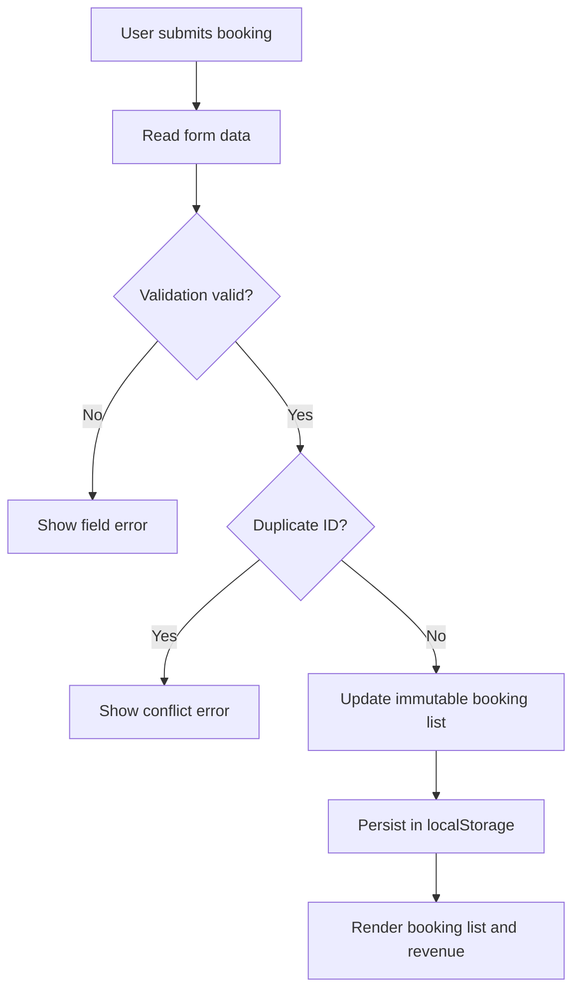

# অধ্যায় ১৬ — JavaScript Error Handling, Debugging, Testing এবং Software Reliability

> **Edition Status:** Reconstructed working draft. আগের ChatGPT Conversation-এর Original Text হুবহু উদ্ধার করা হয়নি। বইয়ের জন্য পুনর্গঠিত শিক্ষামূলক অধ্যায়; Final Editorial ও Browser QA বাকি।

## শেখার লক্ষ্য

এই অধ্যায় শেষে তুমি (১) Error-এর উৎস শনাক্ত, (২) প্রত্যাশিত Validation Failure এবং অপ্রত্যাশিত System Failure আলাদা, (৩) `try/catch/finally` সঠিকভাবে ব্যবহার, (৪) Browser DevTools-এ Debug, (৫) Unit ও Integration Test লিখতে এবং (৬) Reliability-কেন্দ্রিক BookingGuard Application তৈরি করতে পারবে।

## ১৬.১ Software Reliability কেন গুরুত্বপূর্ণ?

কোনো Web Application শুধু *happy path*-এ কাজ করলেই যথেষ্ট নয়। ব্যবহারকারী ভুল Input দিতে পারে, Browser Storage বন্ধ থাকতে পারে, Network Request Timeout হতে পারে কিংবা একই Booking দুবার Submit হতে পারে। Reliability মানে সব Error অদৃশ্য করা নয়; বরং Error হলে Predictable, Recoverable ও Testable Behavior নিশ্চিত করা।

| পরিস্থিতি | দুর্বল আচরণ | নির্ভরযোগ্য আচরণ |
|---|---|---|
| Invalid Email | ভুল Data সংরক্ষণ | Field-specific Validation Message |
| Duplicate Booking | Duplicate Record | Conflict Error |
| Storage Blocked | App Crash | User-facing Warning |
| Unexpected Exception | Blank Screen | Safe Fallback + Diagnostic Log |
| API Timeout | Infinite Spinner | Timeout, Retry Option ও Cancellation |

**মূল নীতি:** User-friendly Message এবং Developer Diagnostic আলাদা। Browser Console-এ Debug Details দেখানো যায়, কিন্তু User-কে Sensitive Stack Trace দেখানো উচিত নয়।

## ১৬.২ Error-এর ধরন

```js
// SyntaxError: কোড Parse করা যায় না
// const name = ;

// ReferenceError: অঘোষিত Identifier
// console.log(unknownVariable);

// TypeError: ভুল ধরনের Operation
// null.toString();

// RangeError: অগ্রহণযোগ্য Range
// new Array(-1);

// JSON Parsing-এর SyntaxError
try {
  JSON.parse('{broken json}');
} catch (error) {
  console.log(error.name); // SyntaxError
}
```

সব Error একইভাবে Handle করা উচিত নয়। ভুল User Input হলে Validation Error; Data Conflict হলে Conflict Error; Programming Bug হলে তা গোপন না করে Log ও Test দিয়ে Fix করতে হবে।

## ১৬.৩ `try`, `catch`, `finally` ও `throw`

```js
function parseSettings(raw) {
  try {
    return JSON.parse(raw);
  } catch (error) {
    console.error('Invalid settings JSON', error);
    return {};
  } finally {
    console.log('Parse attempt finished');
  }
}
```

`finally` সাধারণত Resource Cleanup বা Loading State Reset-এর জন্য উপযোগী। `catch` Block-এ Error নীরবে Ignore করা বিপজ্জনক; Recovery Strategy না থাকলে Error পুনরায় `throw` করা যুক্তিযুক্ত।

```js
function assertPositivePrice(price) {
  if (!Number.isFinite(price) || price <= 0) {
    throw new RangeError('Price must be a positive finite number');
  }
  return price;
}
```

## ১৬.৪ Custom Error Classes

Domain-specific Error ব্যবহার করলে UI Layer সিদ্ধান্ত নিতে পারে কী Message দেখাবে।

```js
class ValidationError extends Error {
  constructor(field, message) {
    super(message);
    this.name = 'ValidationError';
    this.field = field;
  }
}

function validateSeats(seats) {
  if (!Number.isSafeInteger(seats) || seats < 1 || seats > 9) {
    throw new ValidationError('seats', 'Seats must be 1–9');
  }
  return seats;
}
```

`instanceof ValidationError` দিয়ে পরিচিত Validation Failure আলাদা করা যায়। কিন্তু Third-party Error বা Cross-realm Error-এ শুধু `instanceof`-এর ওপর নির্ভর করা সবসময় যথেষ্ট নয়।

## ১৬.৫ Defensive Programming এবং Input Boundaries

**Boundary Validation:** Browser Form-এর `required` বা `min` Attribute ভালো User Experience দেয়, কিন্তু এগুলো Security Boundary নয়। Backend-এ একই নিয়ম স্বাধীনভাবে Validate করতে হবে।

```js
function parseQuantity(value) {
  const quantity = Number(value);
  if (!Number.isSafeInteger(quantity) || quantity < 1 || quantity > 9) {
    throw new Error('Quantity must be an integer between 1 and 9');
  }
  return quantity;
}
```

`Number('')` শূন্য হয়—তাই খালি Input আলাদা করে Reject করতে চাইলে `String(value).trim()` আগে পরীক্ষা করো। `Number.isFinite()` দিয়ে `NaN` ও `Infinity` Reject করো। Financial Calculation-এ Floating-point Precision গুরুত্বপূর্ণ; Production Payment System-এ Minor Currency Unit (যেমন পয়সা) Integer হিসেবে বা Decimal Library ব্যবহার করো।

## ১৬.৬ Async Error Handling

```js
async function loadBookings(signal) {
  const response = await fetch('/api/bookings', { signal });
  if (!response.ok) {
    throw new Error(`HTTP ${response.status}`);
  }
  return response.json();
}

async function refreshBookings() {
  const controller = new AbortController();
  try {
    const bookings = await loadBookings(controller.signal);
    console.log(bookings);
  } catch (error) {
    if (error.name === 'AbortError') return;
    console.error('Could not refresh bookings', error);
  }
}
```

`fetch()` সাধারণত HTTP 404/500-এ Promise Reject করে না; `response.ok` পরীক্ষা করতে হয়। Cancellation ইচ্ছাকৃত হলে তাকে সাধারণ Network Failure-এর মতো দেখানো উচিত নয়। `Promise.all()`-এ একটি Promise Reject করলে Combined Promise Reject হয়; সব Result জানতে `Promise.allSettled()` ব্যবহার করা যায়।

## ১৬.৭ Debugging: একটি পুনরাবৃত্তিযোগ্য পদ্ধতি

1. **Reproduce:** ঠিক কোন Input-এ Bug হচ্ছে তা লিখে রাখো।
2. **Observe:** Console, Network Tab, Sources এবং Stack Trace দেখো।
3. **Hypothesis:** কোন State বা Function ভুল করছে অনুমান করো।
4. **Isolate:** সবচেয়ে ছোট Reproduction তৈরি করো।
5. **Fix:** Root Cause সংশোধন করো, শুধু Symptom নয়।
6. **Regression Test:** একই Bug যেন ফিরে না আসে, তার Automated Test লেখো।

```js
function calculateTotal(items) {
  debugger; // DevTools খোলা থাকলে এখানে Pause করবে
  return items.reduce((sum, item) => sum + item.price * item.quantity, 0);
}
```

`console.table(items)` Array/Object Data তুলনা করতে সহায়ক। `console.assert(condition, message)` Development Diagnostic-এর জন্য; Business Validation-এর বিকল্প নয়। Production Code-এ অপ্রয়োজনীয় `debugger` Statement সরিয়ে ফেলো।

## ১৬.৮ Testing Pyramid এবং Test Types

| Test Type | লক্ষ্য | উদাহরণ |
|---|---|---|
| Unit Test | একক Function-এর আচরণ | `validateBooking()` |
| Integration Test | একাধিক Component-এর সংযোগ | Form → Domain → Storage |
| End-to-End Test | বাস্তব User Journey | Browser-এ Booking Confirm |
| Regression Test | পুরোনো Bug পুনরায় না হওয়া | Duplicate ID Reject |
| Boundary Test | Minimum/Maximum Limit | 0, 1, 9, 10 Seats |

Unit Test দ্রুত, কিন্তু Browser UI কাজ করছে কি না তার নিশ্চয়তা নয়। E2E Test User Journey যাচাই করে, তবে তুলনামূলক ধীর ও Maintenance-heavy। Balanced Testing Strategy দরকার।

## ১৬.৯ Node.js Built-in Test Runner

Node.js-এর `node:test` ও `node:assert/strict` দিয়ে Dependency ছাড়াই Test লেখা যায়।

```js
import test from 'node:test';
import assert from 'node:assert/strict';
import { validateBooking } from './booking-core.mjs';

test('valid booking calculates total', () => {
  const booking = validateBooking({
    customer: 'Amina', email: 'amina@example.com', seats: 2, unitPrice: 350
  });
  assert.equal(booking.total, 700);
});

test('rejects zero seats', () => {
  assert.throws(() => validateBooking({
    customer: 'Amina', email: 'amina@example.com', seats: 0, unitPrice: 350
  }));
});
```

Run: `node --test booking-core.test.mjs`। ভালো Test শুধু Pass হওয়ার জন্য নয়; Failure হলে কেন Fail হয়েছে তা দ্রুত বোঝার জন্য।

## ১৬.১০ Test Doubles: Stub, Mock ও Fake

**Stub** নির্ধারিত Return Value দেয়। **Spy/Mock** Function Call-এর Behaviour পরীক্ষা করে। **Fake** হলো সহজ In-memory Implementation, যেমন Test Storage।

```js
const fakeStorage = {
  getItem(key) {
    return key === 'bookings' ? '[{"id":"BK-1"}]' : null;
  }
};

console.log(fakeStorage.getItem('bookings'));
```

Test-এ বাস্তব Network/Payment Gateway ব্যবহার না করে Controlled Dependency Injection করো। এতে Test Deterministic হয়।

## ১৬.১১ Practical Project — BookingGuard

**Problem:** Booking Form-এ ভুল Data, Duplicate ID, Storage Failure এবং Cancellation-এর সময় Application Crash বা ভুল Revenue দেখা যায়।

**Solution:** Pure Domain Functions + Browser UI + Storage Adapter + Automated Tests।

### Project Folder

```text
source-code/chapter-16/
├── index.html
├── style.css
├── booking-core.mjs
├── app.mjs
└── booking-core.test.mjs
```

সম্পূর্ণ File-by-File Runnable Code ZIP-এর `source-code/chapter-16/` Folder-এ দেওয়া হয়েছে। এই অধ্যায়ে Core Logic ব্যাখ্যা করছি; Source Folder-কে Manuscript-এর অবিচ্ছেদ্য অংশ হিসেবে সংরক্ষণ করবে।

### Data Flow



### Domain Function

```js
export function summarizeBookings(bookings) {
  const active = bookings.filter(item => item.status === 'confirmed');
  return {
    totalBookings: bookings.length,
    confirmed: active.length,
    revenue: Math.round(active.reduce((sum, item) => sum + item.total, 0) * 100) / 100
  };
}
```

Cancellation-এর পরে `confirmed` Count ও Revenue কমবে; Original Array Mutation না করে New Array Return করা হয়েছে। UI-তে `textContent` ব্যবহার করে User Data Render করা হয়েছে, যাতে HTML Injection-এর ঝুঁকি কমে।

### Run Instructions

1. `source-code/chapter-16/` Folder-এ যাও।
2. Terminal-এ `python -m http.server 8000` চালাও।
3. Browser-এ `http://localhost:8000` খোলো।
4. Test চালাও: `node --test booking-core.test.mjs`।
5. Invalid Email, Zero Seats, Cancel এবং Browser Storage Blocked Scenario পরীক্ষা করো।

**Limitations:** এটি Learning Demo; Authentication, Server-side Validation, Payment Processing, Concurrent Booking Control বা Real Database নেই। `localStorage` Production Booking Database নয়।

## ১৬.১২ Error-handling Anti-patterns

**Anti-pattern 1: Silent Catch**

```js
try { riskyOperation(); } catch (error) { /* ignored */ }
```

এতে Failure লুকিয়ে যায়। Recovery Strategy থাকলে তা Document করো; না থাকলে Log বা Re-throw করো।

**Anti-pattern 2: Error Message থেকে HTML Injection**

```js
// ভুল: element.innerHTML = error.message;
// ভালো: element.textContent = error.message;
```

**Anti-pattern 3: শুধু Happy-path Test** — Invalid, Empty, Boundary, Duplicate ও Cancellation Case অবশ্যই Test করো।

**Anti-pattern 4: Client-side Validation-কে Security মনে করা** — Server-side Revalidation অপরিহার্য।

## ১৬.১৩ Hands-on Exercises

1. `validateBooking()`-এ Customer Name-এর Maximum Length 80 থেকে 60 করো।
2. Seats-এর Boundary Values 0, 1, 9, 10-এর জন্য Test লেখো।
3. Duplicate Booking ID-এর জন্য `ConflictError` Assert করো।
4. `cancelBooking()`-এ Missing ID-এর জন্য Error Test লেখো।
5. `summarizeBookings()`-এ Cancelled Booking Revenue বাদ যাচ্ছে কি না Test করো।
6. Storage-এর `getItem()` Exception Throw করলে কী হয় পরীক্ষা করো।
7. UI-তে Error Message-এর জন্য `aria-live` কেন দরকার ব্যাখ্যা করো।
8. `fetch()` HTTP 500 Response-এর জন্য Testable Wrapper তৈরি করো।
9. Error Handling-এ `finally` দিয়ে Loading Indicator Reset করো।
10. BookingGuard-এর জন্য Browser E2E Test Case Outline লেখো।

## ১৬.১৪ Exercise Solutions (Sample)

**১.** `customer.length > 60` Check ব্যবহার করো এবং Error Message-ও আপডেট করো।

**২.**

```js
for (const seats of [0, 10]) {
  assert.throws(() => validateBooking({
    customer: 'Amina', email: 'amina@example.com', seats, unitPrice: 100
  }));
}
for (const seats of [1, 9]) {
  assert.equal(validateBooking({
    customer: 'Amina', email: 'amina@example.com', seats, unitPrice: 100
  }).seats, seats);
}
```

**৩.** `assert.throws(() => addBooking([booking], booking), ConflictError)`।

**৪.** `assert.throws(() => cancelBooking([], 'missing'), ValidationError)`।

**৫.** একটি Confirmed ও একটি Cancelled Booking দিয়ে `revenue`-তে শুধু Confirmed Amount Assert করো।

**৬.** Fake Storage-এর `getItem()` থেকে Error Throw করিয়ে `safeReadBookings()` Empty Array Return করছে কি না দেখো।

**৭.** `aria-live="polite"` Screen Reader-কে নতুন Status Message ঘোষণা করতে সাহায্য করে।

**৮.**

```js
async function getJSON(url, fetchImpl = fetch) {
  const response = await fetchImpl(url);
  if (!response.ok) throw new Error(`HTTP ${response.status}`);
  return response.json();
}
// Test-এ fetchImpl হিসেবে Stub Function Pass করো।
```

**৯.**

```js
async function withLoading(task, setLoading) {
  setLoading(true);
  try { return await task(); }
  finally { setLoading(false); }
}
```

**১০.** Browser-এ Valid Booking Submit → Confirmation Visible → Cancel Click → Revenue Zero → Reload → Cancelled State Persist—এই Journey Test করো।

## ১৬.১৫ MCQ — Final Knowledge Check

**১.** `finally` কখন Run করে? A) শুধু Success B) সাধারণত `try/catch` Completion-এর পরে C) শুধু SyntaxError D) কখনো না

**২.** `fetch()`-এ HTTP 404 হলে সাধারণত কী হয়? A) Promise সবসময় Reject B) Response Resolve হতে পারে C) Browser বন্ধ D) JSON Automatic Empty

**৩.** `assert.throws()` কী Test করে? A) Function Throw করে B) Promise Resolve C) CSS D) HTTP Status

**৪.** Duplicate ID কোন Error-এর উদাহরণ? A) Validation B) Conflict C) Syntax D) Range

**৫.** Pure Function-এর সুবিধা কী? A) Random Output B) Deterministic Testing C) Browser Required D) Global Mutation

**৬.** `textContent` কেন ভালো? A) HTML Execute করে B) Text Render করে C) Database Save করে D) Network Call করে

**৭.** `localStorage` Production Booking Database? A) হ্যাঁ B) না C) শুধু Chrome-এ D) শুধু Offline

**৮.** Regression Test-এর লক্ষ্য? A) UI Design B) পুরোনো Bug ফিরে আসা আটকানো C) Images Compress D) Hosting

**৯.** `AbortError` সাধারণত কী বোঝায়? A) Cancellation B) Syntax Failure C) Duplicate ID D) CSS Error

**১০.** Unit Test Pass মানে কি Browser UI নিশ্চিতভাবে ঠিক? A) হ্যাঁ B) না C) শুধু Mobile D) শুধু Server

### MCQ Answer Key ও Explanation

1. **B** — `finally` সাধারণত `try/catch` শেষে চলে; Process Termination-এর মতো ব্যতিক্রম থাকতে পারে।
2. **B** — `response.ok` পরীক্ষা জরুরি।
3. **A** — Synchronous Exception Assert করে; Async Rejection-এর জন্য `assert.rejects()`।
4. **B** — Duplicate ID একটি Conflict Scenario।
5. **B** — Same Input → Same Output হলে Test সহজ হয়।
6. **B** — `textContent` HTML Markup Interpret করে না।
7. **B** — Production-এর জন্য Server-side Storage ও Validation দরকার।
8. **B** — Fixed Bug-এর জন্য Automated Guard তৈরি করে।
9. **A** — ইচ্ছাকৃত Request Cancellation হতে পারে।
10. **B** — UI আলাদাভাবে Integration/E2E Test করতে হয়।

## ১৬.১৬ Chapter Recap

Reliable JavaScript মানে Error-free হওয়ার দাবি নয়; Failure Predict, Detect, Handle ও Test করার দক্ষতা। এই অধ্যায়ে Custom Errors, Boundary Validation, Async Error Handling, Debugging, Unit Testing এবং BookingGuard Project-এর মাধ্যমে এই ধারণাগুলো বাস্তবে প্রয়োগ করেছ। পরবর্তী অধ্যায়ে Regular Expressions ও Secure Input Processing আরও গভীরভাবে শিখবে।
