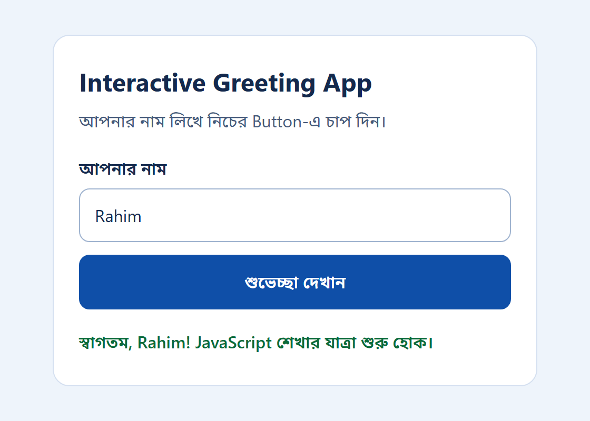

# অধ্যায় ১ — JavaScript-এর জগতে প্রথম পদক্ষেপ

## শেখার লক্ষ্য

এই অধ্যায় শেষ করার পর আপনি পারবেন:

- Programming বলতে কী বোঝায় এবং JavaScript কোন ধরনের কাজে ব্যবহৃত হয়, তা নিজের ভাষায় ব্যাখ্যা করতে।
- JavaScript কোথায় চলে (Browser ও Node.js) এবং Java-র সঙ্গে এর পার্থক্য কী, তা বলতে।
- নিজের Computer-এ Browser, VS Code এবং Node.js দিয়ে একটি কাজের পরিবেশ তৈরি করতে।
- Browser Console এবং Node.js—দুই জায়গাতেই JavaScript Code চালাতে।
- String, Semicolon, Comment এবং Case Sensitivity-র মৌলিক নিয়ম মেনে Code লিখতে।
- একটি Error Message পড়ে ভুলের ধরন ও জায়গা খুঁজে বের করতে।
- একটি HTML Page-এ JavaScript File যুক্ত করে Button Click-এ Page-এর লেখা বদলাতে।
- সম্পূর্ণ একটি ছোট Application—**Interactive Greeting App**—নিজে তৈরি করে চালাতে।

## পূর্বশর্ত

এই অধ্যায়ের জন্য আগে থেকে Programming জানার প্রয়োজন নেই। আপনার যা লাগবে:

- একটি Computer (Windows, macOS অথবা Linux) এবং Software Install করার অনুমতি।
- File ও Folder তৈরি করা, নাম বদলানো এবং Keyboard-এ টাইপ করার সাধারণ অভ্যাস।
- Software Download করার জন্য Internet সংযোগ।
- প্রতিটি উদাহরণ নিজে টাইপ করে চালিয়ে দেখার ধৈর্য।

## এই অধ্যায় কেন গুরুত্বপূর্ণ

নতুন ভাষা শেখার সময় সবচেয়ে বড় বাধা সাধারণত ভাষাটি নয়; বাধা হলো প্রথম Program-টি চালাতে না পারা। কোথায় Code লিখতে হবে, কীভাবে চালাতে হবে, লাল রঙের Error দেখালে কী করতে হবে—এই প্রশ্নগুলোর উত্তর জানা না থাকলে শেখা শুরুতেই থেমে যায়।

এই অধ্যায়ে তাই তিনটি ভিত্তি তৈরি করা হবে। প্রথমত, আপনি জানবেন JavaScript কী এবং কোথায় ব্যবহৃত হয়। দ্বিতীয়ত, আপনার Computer-এ এমন একটি পরিবেশ প্রস্তুত হবে, যা বইয়ের বাকি সব অধ্যায়ে কাজে লাগবে। তৃতীয়ত, আপনি Code লেখা, চালানো এবং ভুল খুঁজে ঠিক করার পুরো চক্রটি নিজের হাতে একবার সম্পন্ন করবেন।

অধ্যায়ের শেষে আপনার হাতে একটি সম্পূর্ণ কাজ করা Web Application থাকবে। এটি ছোট, কিন্তু এর প্রতিটি লাইন আপনি বুঝবেন।

## ১.১ Programming কী

Computer নিজে থেকে কিছু করে না; তাকে প্রতিটি কাজ ধাপে ধাপে বলে দিতে হয়। এই ধাপে ধাপে লেখা নির্দেশনার সমষ্টিকে **Program** বলা হয়, আর Program লেখার কাজকে বলা হয় **Programming**।

একটি রান্নার প্রণালির কথা ভাবুন। সেখানে উপকরণ, পরিমাণ এবং কাজের ক্রম নির্দিষ্টভাবে লেখা থাকে। ক্রম উল্টে গেলে বা একটি ধাপ বাদ পড়লে ফল ঠিক আসে না। Program-ও তেমনই: Computer নির্দেশনাগুলো ঠিক যেভাবে লেখা আছে সেভাবেই পালন করে, আপনি কী বোঝাতে চেয়েছিলেন তা অনুমান করে না।

মানুষের ভাষায় নির্দেশ দিলে Computer বোঝে না, কারণ সে ভাষায় একই কথার অনেক অর্থ হতে পারে। তাই নির্দিষ্ট নিয়মে বাঁধা ভাষা ব্যবহার করা হয়, যাকে বলে **Programming Language**। JavaScript তেমনই একটি ভাষা।

## ১.২ JavaScript কী এবং কেন শিখবেন

JavaScript একটি Programming Language, যা ১৯৯৫ সালে Web Page-কে সচল ও ব্যবহারকারীর কাজে সাড়া দিতে সক্ষম করার জন্য তৈরি হয়েছিল। আজ এটি Web-এর মূল তিনটি প্রযুক্তির একটি:

| প্রযুক্তি | কাজ | উদাহরণ |
| --- | --- | --- |
| HTML | Page-এর কাঠামো ও বিষয়বস্তু | শিরোনাম, অনুচ্ছেদ, Button, Form |
| CSS | Page-এর চেহারা | রং, Font, ফাঁকা জায়গা, বিন্যাস |
| JavaScript | Page-এর আচরণ | Button চাপলে কী হবে, Form ঠিকভাবে পূরণ হয়েছে কি না |

একটি বাড়ির সঙ্গে তুলনা করলে HTML হলো দেয়াল ও ঘর, CSS হলো রং ও সাজসজ্জা, আর JavaScript হলো বিদ্যুতের সুইচ—যা চাপলে কিছু একটা ঘটে।

### JavaScript কোথায় চলে

JavaScript Code চালানোর জন্য একটি **Runtime** প্রয়োজন, অর্থাৎ এমন একটি Software যা Code পড়ে সেটি কার্যকর করে। সবচেয়ে প্রচলিত দুটি Runtime হলো:

- **Browser:** Chrome, Edge, Firefox, Safari—প্রতিটি Browser-এর ভেতরে JavaScript চালানোর ব্যবস্থা আছে। এখানে JavaScript Web Page-এর সঙ্গে কাজ করে।
- **Node.js:** এটি Browser-এর বাইরে, সরাসরি আপনার Computer বা Server-এ JavaScript চালায়। Node.js দিয়ে Server, Command-line Tool এবং নানা ধরনের স্বয়ংক্রিয় কাজ তৈরি করা যায়।

ভাষা একই, কিন্তু পরিবেশ আলাদা। Browser-এ Web Page থাকে, তাই সেখানে Page-এর Button বা লেখা নিয়ে কাজ করা যায়। Node.js-এ Web Page নেই, তবে File পড়া-লেখা বা Server চালানোর সুবিধা আছে। এই পার্থক্য পুরো বইজুড়ে মনে রাখতে হবে।

### JavaScript এবং Java এক নয়

নামের মিল থাকলেও JavaScript এবং Java সম্পূর্ণ আলাদা দুটি ভাষা। এদের নিয়ম, চালানোর পদ্ধতি এবং ব্যবহারের ক্ষেত্র ভিন্ন। নামের এই মিল ঐতিহাসিক; প্রযুক্তিগত কোনো সম্পর্ক এতে বোঝায় না। Java শিখলে JavaScript জানা হয় না, আবার JavaScript শিখলেও Java জানা হয় না।

### বাস্তবে JavaScript দিয়ে কী তৈরি হয়

- Online দোকানের Cart, যেখানে পণ্য যোগ করলে মোট দাম সঙ্গে সঙ্গে বদলায়।
- Form, যা ভুল Email বা ফাঁকা ঘর থাকলে জমা দেওয়ার আগেই সতর্ক করে।
- Map, Chat, Video Call এবং Online Editor-এর মতো Browser-ভিত্তিক Application।
- Server-side API, যা Mobile App বা Website-কে Data সরবরাহ করে।
- Developer-দের ব্যবহারের Tool, যেমন Code পরীক্ষা বা Build করার Program।

### Frontend, Backend এবং Full-Stack

Web Application সাধারণত দুটি অংশে ভাগ করা হয়।

- **Frontend:** ব্যবহারকারী যা দেখেন এবং যার সঙ্গে সরাসরি কাজ করেন। এটি Browser-এ চলে এবং HTML, CSS ও JavaScript দিয়ে তৈরি।
- **Backend:** পর্দার আড়ালের অংশ, যা Server-এ চলে। Data সংরক্ষণ, হিসাব-নিকাশ এবং নিরাপত্তা যাচাই এখানে হয়।

যিনি দুটো অংশেই কাজ করতে পারেন, তাঁকে **Full-Stack Developer** বলা হয়। JavaScript-এর একটি বড় সুবিধা হলো একই ভাষা দিয়ে Frontend (Browser) এবং Backend (Node.js)—দুই দিকেই কাজ করা যায়।

## ১.৩ এই বই থেকে কী শিখবেন

বইটি ৩০টি অধ্যায়ে চারটি ধাপে সাজানো:

| অধ্যায় | ধাপ | বিষয় |
| --- | --- | --- |
| ১–৯ | মৌলিক ভিত্তি | Variable, Data Type, Operator, Loop, Function, Array, Object, String, DOM ও Event |
| ১০–১৮ | আধুনিক JavaScript | Asynchronous Programming, Error Handling, Module, OOP, Browser API, Testing |
| ১৯–২৪ | পেশাদার Engineering | Performance, Security, Design Pattern, TypeScript |
| ২৫–৩০ | Backend থেকে System Design | Node.js Backend, Database, Deployment এবং পূর্ণাঙ্গ Project |

এই অধ্যায়ে কয়েকটি বিষয়—যেমন Variable, Function এবং DOM—শুধু পরিচয় পর্যায়ে আসবে, যাতে আপনি প্রথম Project-টি তৈরি করতে পারেন। প্রতিটি বিষয়ের বিস্তারিত আলোচনা পরের অধ্যায়গুলোতে আছে।

## ১.৪ Development Environment প্রস্তুত করা

Code লেখা ও চালানোর জন্য যে Software-গুলো লাগে, সেগুলোকে একসঙ্গে **Development Environment** বলা হয়। এই বইয়ের জন্য তিনটি জিনিস প্রয়োজন: একটি আধুনিক Browser, একটি Code Editor এবং Node.js। তিনটিই বিনামূল্যে পাওয়া যায়।

> **সতর্কতা:** Software সব সময় নির্মাতার নিজস্ব Website থেকে Download করুন। অন্য কোনো Website-এর Installer-এ ক্ষতিকর Program থাকতে পারে।

### ধাপ ১: একটি আধুনিক Browser

Google Chrome, Microsoft Edge অথবা Mozilla Firefox—যেকোনো একটি হালনাগাদ Browser যথেষ্ট। আপনার Computer-এ এর কোনোটি আগে থেকে থাকলে নতুন করে Install করার দরকার নেই; শুধু সেটি Update করে নিন। এই বইয়ের Screenshot ও বর্ণনায় Chrome ব্যবহার করা হয়েছে, তবে Edge এবং Firefox-এও একই কাজ প্রায় একইভাবে করা যায়।

### ধাপ ২: Visual Studio Code

Code যেকোনো সাধারণ Text Editor-এ লেখা যায়, কিন্তু একটি **Code Editor** কাজটি অনেক সহজ করে। এটি Code-এর বিভিন্ন অংশ আলাদা রঙে দেখায়, বন্ধনী মেলাতে সাহায্য করে এবং ভেতরেই Terminal চালানোর সুবিধা দেয়। এই বইয়ে Visual Studio Code (সংক্ষেপে VS Code) ব্যবহার করা হয়েছে।

1. `https://code.visualstudio.com` ঠিকানায় যান।
2. আপনার Operating System-এর জন্য Installer Download করুন।
3. Installer চালিয়ে নির্দেশনা অনুসরণ করুন। Default Option-গুলো সাধারণত ঠিক থাকে।

> **নোট:** Microsoft Word বা অনুরূপ Word Processor-এ Code লিখবেন না। এগুলো লেখার সঙ্গে অদৃশ্য Formatting যোগ করে এবং Quotation Mark বদলে দেয়, ফলে Code চলে না।

### ধাপ ৩: Node.js

1. `https://nodejs.org` ঠিকানায় যান।
2. **LTS** চিহ্নিত সংস্করণটি Download করুন। LTS-এর পূর্ণরূপ Long Term Support; এই সংস্করণ দীর্ঘ সময় ধরে রক্ষণাবেক্ষণ করা হয় এবং শেখার জন্য এটিই উপযুক্ত।
3. Installer চালিয়ে Default Option রেখে Install সম্পন্ন করুন।

Node.js-এর সঙ্গে **npm** নামে আরেকটি Tool স্বয়ংক্রিয়ভাবে Install হয়। npm দিয়ে অন্যদের তৈরি Code Package ব্যবহার করা যায়। এই অধ্যায়ে npm ব্যবহার করা হবে না, তবে এটি ঠিকভাবে Install হয়েছে কি না তা যাচাই করে রাখা ভালো।

> **নোট:** Node.js-এর সংস্করণ নিয়মিত বদলায়, তাই এই বইয়ে নির্দিষ্ট কোনো সংখ্যা Install করতে বলা হয়নি। Website-এ যেটি LTS হিসেবে চিহ্নিত, সেটিই নিন। এই অধ্যায়ের উদাহরণগুলো লেখকের Computer-এ Node.js v22.16.0 দিয়ে চালিয়ে দেখা হয়েছে।

### ধাপ ৪: Terminal খুলে Install যাচাই করা

**Terminal** হলো এমন একটি জানালা, যেখানে Mouse দিয়ে Click করার বদলে লিখে Computer-কে নির্দেশ দেওয়া হয়। প্রতিটি নির্দেশকে **Command** বলে। VS Code-এর ভেতরেই একটি Terminal আছে:

- Menu থেকে **Terminal > New Terminal** বেছে নিন, অথবা
- Keyboard-এ `Ctrl` এবং `` ` `` (Backtick, সাধারণত `Esc` Key-র নিচে থাকে) একসঙ্গে চাপুন।

Terminal খুললে নিচের দুটি Command আলাদাভাবে লিখে প্রতিবার `Enter` চাপুন।

```bash kind=terminal
node --version
npm --version
```

প্রতিটি Command-এর পর একটি সংস্করণ সংখ্যা দেখা যাবে। লেখকের Computer-এ ফল ছিল এমন:

```text kind=output
v22.16.0
10.9.2
```

আপনার সংখ্যা ভিন্ন হলে সমস্যা নেই; সংখ্যা দেখানোই প্রমাণ যে Install সফল হয়েছে। যদি `command not found` অথবা `is not recognized` জাতীয় বার্তা আসে, তাহলে VS Code সম্পূর্ণ বন্ধ করে আবার খুলুন। তাতেও কাজ না হলে Computer Restart করে পুনরায় চেষ্টা করুন, কারণ নতুন Install করা Program অনেক সময় Restart-এর পর Terminal-এ পাওয়া যায়।

### ধাপ ৫: Project Folder তৈরি করা

বইয়ের সব কাজ একটি নির্দিষ্ট Folder-এ রাখলে পরে খুঁজে পাওয়া সহজ হয়।

1. Documents বা সুবিধাজনক কোনো জায়গায় `javascript-mastery` নামে একটি Folder তৈরি করুন।
2. তার ভেতরে `chapter-01` নামে আরেকটি Folder তৈরি করুন।
3. VS Code-এ **File > Open Folder** থেকে `chapter-01` Folder-টি খুলুন।

Folder ও File-এর নামে ফাঁকা জায়গা এবং বাংলা অক্ষর ব্যবহার না করাই ভালো। ছোট হাতের ইংরেজি অক্ষর, সংখ্যা এবং হাইফেন (`-`) ব্যবহার করুন, যেমন `chapter-01`। এতে Terminal-এ কাজ করার সময় জটিলতা কমে।

### ধাপ ৬: File তৈরি, সংরক্ষণ এবং File Extension

VS Code-এর বাঁ পাশের Explorer অংশে **New File** চিহ্নে Click করে File তৈরি করা যায়। নামের শেষের অংশটিকে **File Extension** বলে; এটি দেখে Computer ও Editor বোঝে File-টি কোন ধরনের।

| Extension | File-এর ধরন | উদাহরণ |
| --- | --- | --- |
| `.html` | Web Page-এর কাঠামো | `index.html` |
| `.css` | Web Page-এর চেহারা | `style.css` |
| `.js` | JavaScript Code | `app.js` |

File-এ কিছু লেখার পর `Ctrl + S` (macOS-এ `Cmd + S`) চেপে Save করতে হয়। VS Code-এ File-এর নামের পাশে একটি গোল বিন্দু দেখা গেলে বুঝবেন, পরিবর্তন এখনো Save হয়নি।

> **সতর্কতা:** নতুনদের সবচেয়ে প্রচলিত ভুলগুলোর একটি হলো Save না করে Code চালানো। তখন Computer পুরোনো File-টিই চালায় এবং মনে হয় পরিবর্তন কাজ করছে না।

Windows অনেক সময় File Extension লুকিয়ে রাখে। ফলে `app.js` ভেবে তৈরি করা File-এর আসল নাম `app.js.txt` হয়ে যেতে পারে। File Explorer-এর **View** Menu থেকে **File name extensions** চালু করে নিলে আসল নাম দেখা যায়। VS Code-এর ভেতর থেকে File তৈরি করলে এই সমস্যা হয় না।

### প্রয়োজনীয় Terminal Command

নিচের কয়েকটি Command জানলেই এই বইয়ের কাজ চালানো যাবে। VS Code-এর Terminal Windows-এ সাধারণত PowerShell এবং macOS ও Linux-এ zsh বা bash ব্যবহার করে; নিচের Command-গুলো এসব জায়গাতেই কাজ করে।

| কাজ | Windows (PowerShell) | macOS / Linux |
| --- | --- | --- |
| এখন কোন Folder-এ আছি দেখা | `pwd` | `pwd` |
| Folder-এর File-এর তালিকা দেখা | `ls` | `ls` |
| কোনো Folder-এ প্রবেশ করা | `cd chapter-01` | `cd chapter-01` |
| এক ধাপ ওপরের Folder-এ যাওয়া | `cd ..` | `cd ..` |
| নতুন Folder তৈরি করা | `mkdir practice` | `mkdir practice` |
| Terminal-এর লেখা মুছে ফেলা | `cls` | `clear` |
| একটি JavaScript File চালানো | `node hello.js` | `node hello.js` |

VS Code-এ কোনো Folder খোলা থাকলে নতুন Terminal সেই Folder থেকেই শুরু হয়। তাই শুরুতে সাধারণত `cd` ব্যবহার করার প্রয়োজন পড়ে না।

## ১.৫ প্রথম JavaScript Program

নতুন কোনো ভাষা শেখার প্রথম Program সাধারণত পর্দায় একটি বাক্য দেখায়। JavaScript-এ এ কাজে `console.log()` ব্যবহার করা হয়।

```javascript run=both
console.log('Hello, JavaScript!');
```

```text kind=output
Hello, JavaScript!
```

এই এক লাইনের প্রতিটি অংশের অর্থ আছে:

| অংশ | অর্থ |
| --- | --- |
| `console` | **Console**—Developer-দের জন্য বার্তা দেখানোর জায়গা। |
| `.` | Console-এর ভেতরের একটি সুবিধা ব্যবহার করা হচ্ছে, তা বোঝায়। |
| `log` | "লিখে রাখো"—Console-এ একটি বার্তা দেখানোর নির্দেশ। |
| `( )` | বন্ধনীর ভেতরে থাকে যা দেখাতে হবে। |
| `'Hello, JavaScript!'` | Quotation Mark-এ ঘেরা লেখা, যাকে **String** বলে। |
| `;` | নির্দেশটি এখানে শেষ। |

`console.log()` ব্যবহারকারীর জন্য নয়; এটি Developer-এর নিজের দেখার জন্য। Program কোন পথে চলছে বা কোনো মান কত, তা যাচাই করতে এটি বারবার কাজে লাগবে।

### পদ্ধতি ১: Browser Console-এ চালানো

প্রতিটি আধুনিক Browser-এ **Developer Tools** (সংক্ষেপে DevTools) নামে একটি অংশ থাকে, যার ভেতরে Console আছে।

1. Browser-এ একটি নতুন Tab খুলুন।
2. `F12` চাপুন, অথবা Windows ও Linux-এ `Ctrl + Shift + I`, macOS-এ `Cmd + Option + I` চাপুন।
3. খোলা অংশের ওপরের দিক থেকে **Console** Tab বেছে নিন।
4. `>` চিহ্নের পাশে ওপরের লাইনটি টাইপ করে `Enter` চাপুন।

বার্তাটির নিচে `undefined` লেখা দেখা যাবে। এটি কোনো ভুল নয়। Console প্রতিটি নির্দেশের ফলাফল দেখায়; `console.log()` শুধু বার্তা দেখায় এবং কোনো ফলাফল ফেরত দেয় না বলে `undefined` (অর্থাৎ "কোনো মান নেই") দেখানো হয়। আপাতত এটি উপেক্ষা করুন।

> **পরামর্শ:** শুরুর দিকে Code Copy-Paste না করে নিজে টাইপ করুন। টাইপ করার সময় যে ছোট ভুলগুলো হয়, সেগুলো ঠিক করতে গিয়েই ভাষার নিয়ম সবচেয়ে ভালোভাবে শেখা হয়।

Browser Console ছোট পরীক্ষার জন্য চমৎকার, কিন্তু Tab বন্ধ করলে লেখা Code হারিয়ে যায়। স্থায়ীভাবে Code রাখতে File ব্যবহার করতে হয়।

### পদ্ধতি ২: Node.js দিয়ে File চালানো

1. VS Code-এ `chapter-01` Folder-এর ভেতরে `hello.js` নামে একটি File তৈরি করুন।
2. File-এ নিচের লাইনটি লিখে Save করুন।

```javascript run=node file=hello.js
console.log('Hello, JavaScript!');
```

3. Terminal খুলে নিচের Command চালান।

```bash kind=terminal
node hello.js
```

```text kind=output
Hello, JavaScript!
```

`node hello.js` Command-টির অর্থ: "Node.js, `hello.js` File-এর Code চালাও।" লক্ষ করুন, এখানে `undefined` দেখায়নি। কারণ Node.js File চালানোর সময় শুধু সেই লেখাই দেখায়, যা আপনি `console.log()` দিয়ে দেখাতে বলেছেন।

### একাধিক লাইন এবং বিভিন্ন ধরনের মান

Program-এর লাইনগুলো ওপর থেকে নিচে, একটির পর একটি চলে। `values.js` নামে নতুন File তৈরি করে নিচের Code লিখুন।

```javascript run=both file=values.js
console.log('আমার প্রথম JavaScript Program');
console.log(2026);
console.log(10 + 5);
console.log('10 + 5');
```

```text kind=output
আমার প্রথম JavaScript Program
2026
15
10 + 5
```

শেষ দুটি লাইনের পার্থক্য গুরুত্বপূর্ণ। Quotation Mark ছাড়া `10 + 5` একটি হিসাব, তাই JavaScript যোগ করে `15` দেখায়। Quotation Mark-এর ভেতরে `'10 + 5'` শুধুই লেখা, তাই সেটি হুবহু দেখানো হয়। Quotation Mark থাকা বা না থাকার ওপর নির্ভর করে JavaScript একই অক্ষরগুলোকে সম্পূর্ণ ভিন্নভাবে বোঝে।

## ১.৬ JavaScript লেখার মৌলিক নিয়ম

প্রতিটি ভাষার যেমন ব্যাকরণ আছে, Programming Language-এরও তেমন নিয়ম আছে। এই নিয়মগুলোকে **Syntax** বলে। Syntax ভুল হলে Program চলে না।

### String এবং Quotation Mark

লেখা বা অক্ষরের সমষ্টিকে JavaScript-এ **String** বলে। String তিন ধরনের চিহ্ন দিয়ে লেখা যায়:

```javascript run=both file=strings.js
console.log('Single Quote দিয়ে লেখা String');
console.log("Double Quote দিয়ে লেখা String");
console.log(`Backtick দিয়ে লেখা String`);
console.log("It's a good day to learn.");
console.log('শিক্ষক বললেন, "চেষ্টা চালিয়ে যান।"');
```

```text kind=output
Single Quote দিয়ে লেখা String
Double Quote দিয়ে লেখা String
Backtick দিয়ে লেখা String
It's a good day to learn.
শিক্ষক বললেন, "চেষ্টা চালিয়ে যান।"
```

তিনটি নিয়ম মনে রাখুন:

- String যে চিহ্ন দিয়ে শুরু হয়, সেই চিহ্ন দিয়েই শেষ করতে হয়।
- String-এর ভেতরে একটি Quotation Mark দরকার হলে বাইরে অন্য ধরনেরটি ব্যবহার করুন। চতুর্থ লাইনে `It's`-এর ভেতরে Single Quote আছে বলে বাইরে Double Quote দেওয়া হয়েছে।
- এই বইয়ে সাধারণ String-এর জন্য Single Quote ব্যবহার করা হয়েছে। Backtick-এর একটি বিশেষ সুবিধা আছে, যা অনুচ্ছেদ ১.৭-এ দেখানো হবে।

### Statement এবং Semicolon

JavaScript-এর একটি সম্পূর্ণ নির্দেশকে **Statement** বলে। `console.log('Hello');` একটি Statement। বাংলা বাক্যের শেষে যেমন দাঁড়ি বসে, Statement-এর শেষে তেমন Semicolon (`;`) বসে।

JavaScript অনেক ক্ষেত্রে Semicolon ছাড়াও Statement-এর শেষ বুঝে নিতে পারে, তাই কিছু Code-এ Semicolon দেখা যায় না। তবে এই স্বয়ংক্রিয় ব্যবস্থা কিছু বিশেষ ক্ষেত্রে অপ্রত্যাশিত ফল দেয়। এ কারণে এই বইয়ে প্রতিটি Statement-এর শেষে Semicolon দেওয়া হয়েছে, এবং আপনাকেও সেই অভ্যাস করার পরামর্শ দেওয়া হচ্ছে।

### Comment

**Comment** হলো Code-এর ভেতরে মানুষের জন্য লেখা টীকা। JavaScript Comment চালায় না।

```javascript run=both file=comments.js
// এটি এক লাইনের Comment। JavaScript এই লাইন চালায় না।
console.log('প্রথম লাইন চলল।'); // লাইনের শেষেও Comment লেখা যায়

/*
  এটি একাধিক লাইনের Comment।
  বড় ব্যাখ্যা লেখার সময় কাজে লাগে।
*/
console.log('Program শেষ।');
```

```text kind=output
প্রথম লাইন চলল।
Program শেষ।
```

`//` থেকে লাইনের শেষ পর্যন্ত সবকিছু Comment। `/*` থেকে `*/` পর্যন্ত যত লাইনই থাকুক, সবই Comment। ভালো Comment বলে *কেন* কাজটি করা হচ্ছে; Code নিজেই বলে *কী* করা হচ্ছে।

### Case Sensitivity

JavaScript বড় হাতের ও ছোট হাতের অক্ষরকে আলাদা হিসেবে ধরে। একে **Case Sensitivity** বলে। তাই `console`, `Console` এবং `CONSOLE` তিনটি ভিন্ন নাম। একইভাবে `log` এবং `Log` এক নয়। শুরুর দিকের অনেক Error-এর কারণ শুধু একটি অক্ষরের আকার।

## ১.৭ Variable, Function এবং শর্ত: সংক্ষিপ্ত পরিচয়

অধ্যায়ের শেষের Project তৈরি করতে তিনটি ধারণার প্রাথমিক পরিচয় প্রয়োজন। এখানে ঠিক ততটুকুই দেখানো হলো; বিস্তারিত আলোচনা অধ্যায় ২, ৩ এবং ৫-এ আছে।

### Variable: মানকে নাম দেওয়া

**Variable** হলো একটি নাম, যার সঙ্গে একটি মান যুক্ত থাকে। একবার নাম দিলে পরে সেই নাম ব্যবহার করেই মানটি পাওয়া যায়।

### Function: পুনর্ব্যবহারযোগ্য নির্দেশনা

**Function** হলো নাম দেওয়া একগুচ্ছ নির্দেশনা। একবার লিখে রাখলে সেটি যতবার প্রয়োজন, ততবার চালানো যায়।

```javascript run=both file=variables-functions.js
const learnerName = 'Nusrat';
let completedLessons = 0;

console.log(learnerName);
console.log(completedLessons);

completedLessons = 1;
console.log(completedLessons);

function createWelcome(name) {
  return `স্বাগতম, ${name}!`;
}

console.log(createWelcome(learnerName));
console.log(createWelcome('Tanvir'));
```

```text kind=output
Nusrat
0
1
স্বাগতম, Nusrat!
স্বাগতম, Tanvir!
```

ধাপে ধাপে ব্যাখ্যা:

- `const learnerName = 'Nusrat';` — `learnerName` নামে একটি Variable তৈরি হলো, যার মান `'Nusrat'`। `const` দিয়ে তৈরি Variable-এ পরে নতুন মান বসানো যায় না।
- `let completedLessons = 0;` — `let` দিয়ে তৈরি Variable-এর মান পরে বদলানো যায়। সপ্তম লাইনে সেটিই করা হয়েছে।
- `=` চিহ্নের অর্থ এখানে "সমান" নয়; এর অর্থ "ডান পাশের মানটি বাঁ পাশের নামে রাখো।"
- `function createWelcome(name) { ... }` — `createWelcome` নামে একটি Function তৈরি হলো। বন্ধনীর ভেতরের `name` হলো **Parameter**: Function চালানোর সময় যে মান দেওয়া হবে, সেটি এই নামে পাওয়া যাবে। একাধিক Parameter দরকার হলে কমা দিয়ে আলাদা করা হয়, যেমন `(name, city)`।
- `return` — Function-এর ফলাফল ফেরত দেয়।
- `` `স্বাগতম, ${name}!` `` — Backtick-এ লেখা String-এর ভেতরে `${ }` দিয়ে Variable-এর মান বসানো যায়। এটিই Backtick-এর বিশেষ সুবিধা।
- `createWelcome(learnerName)` — Function-টি চালানো হলো। একে Function **Call** করা বলে। একই Function দুটি ভিন্ন নাম দিয়ে দুবার Call করা হয়েছে।

নাম লেখার সময় এই বইয়ে একটি রীতি মানা হয়েছে: প্রথম শব্দ ছোট হাতের অক্ষরে, পরের প্রতিটি শব্দের প্রথম অক্ষর বড় হাতের—যেমন `learnerName`। এই রীতিকে camelCase বলা হয়।

### শর্ত: অবস্থা বুঝে সিদ্ধান্ত নেওয়া

অনেক সময় Program-কে অবস্থা অনুযায়ী ভিন্ন কাজ করতে হয়। এ জন্য `if` ব্যবহার করা হয়।

```javascript run=both file=condition.js
function checkName(name) {
  const cleanName = name.trim();

  if (cleanName === '') {
    return 'নাম লেখা হয়নি।';
  }

  return `নাম পাওয়া গেছে: ${cleanName}`;
}

console.log(checkName('  Karim  '));
console.log(checkName('     '));
```

```text kind=output
নাম পাওয়া গেছে: Karim
নাম লেখা হয়নি।
```

- `name.trim()` — String-এর শুরু ও শেষের ফাঁকা জায়গা বাদ দেয়। `'  Karim  '` হয়ে যায় `'Karim'`, আর শুধু ফাঁকা জায়গার String হয়ে যায় `''`, অর্থাৎ ফাঁকা String।
- `===` — দুই পাশের মান হুবহু এক কি না, তা যাচাই করে। এটি `=` থেকে আলাদা: `=` মান রাখে, `===` তুলনা করে।
- `if (শর্ত) { ... }` — শর্ত সত্য হলে তবেই দ্বিতীয় বন্ধনীর ভেতরের Code চলে।
- `return` চলার সঙ্গে সঙ্গে Function শেষ হয়ে যায়। তাই নাম ফাঁকা হলে নিচের `return` পর্যন্ত আর যাওয়া হয় না।

## ১.৮ Error Message পড়তে শেখা

Code-এ ভুল হলে JavaScript একটি **Error Message** দেখায়। নতুনরা অনেক সময় লাল লেখা দেখে ঘাবড়ে যান, অথচ এই বার্তাই সবচেয়ে বড় সহায়ক: এতে ভুলের ধরন, জায়গা এবং কারণ লেখা থাকে।

নিচে চারটি ইচ্ছাকৃত ভুল এবং Node.js-এ সেগুলোর আসল বার্তা দেখানো হলো। প্রতিটি নিজে চালিয়ে দেখুন।

**ভুল ১: শেষের Quotation Mark নেই**

```javascript run=node file=e1-missing-quote.js
console.log('Hello, JavaScript!);
```

```text kind=error
e1-missing-quote.js:1
console.log('Hello, JavaScript!);
            ^^^^^^^^^^^^^^^^^^^^^

SyntaxError: Invalid or unexpected token
```

**ভুল ২: নামের বানান ভুল**

```javascript run=node file=e2-misspelled-name.js
consol.log('Hello, JavaScript!');
```

```text kind=error
e2-misspelled-name.js:1
consol.log('Hello, JavaScript!');
^

ReferenceError: consol is not defined
```

**ভুল ৩: অক্ষরের আকার ভুল**

```javascript run=node file=e3-wrong-case.js
console.Log('Hello, JavaScript!');
```

```text kind=error
e3-wrong-case.js:1
console.Log('Hello, JavaScript!');
        ^

TypeError: console.Log is not a function
```

**ভুল ৪: শেষের বন্ধনী নেই**

```javascript run=node file=e4-missing-parenthesis.js
console.log('Hello, JavaScript!';
```

```text kind=error
e4-missing-parenthesis.js:1
console.log('Hello, JavaScript!';
            ^^^^^^^^^^^^^^^^^^^^

SyntaxError: missing ) after argument list
```

ওপরের প্রতিটি বার্তার পরে Node.js আরও কয়েকটি লাইন দেখায়, যেগুলো এখানে বাদ দেওয়া হয়েছে। সেগুলো নিয়ে অনুচ্ছেদ ১.১১-এ আলোচনা আছে।

### একটি Error Message-এর চারটি অংশ

1. **File-এর নাম ও লাইন নম্বর** — `e2-misspelled-name.js:1` মানে ভুলটি এই File-এর ১ নম্বর লাইনে।
2. **সংশ্লিষ্ট লাইন** — যে লাইনে সমস্যা, সেটি হুবহু দেখানো হয়।
3. **`^` চিহ্ন** — লাইনের ঠিক কোন জায়গায় সমস্যা ধরা পড়েছে, তা দেখায়।
4. **Error-এর ধরন ও বর্ণনা** — যেমন `ReferenceError: consol is not defined`।

### তিনটি প্রচলিত Error-এর ধরন

| ধরন | অর্থ | সাধারণ কারণ |
| --- | --- | --- |
| `SyntaxError` | Code-এর গঠন ভাষার নিয়ম মানছে না | Quotation Mark বা বন্ধনী বাদ পড়া |
| `ReferenceError` | এমন একটি নাম ব্যবহার করা হয়েছে, যা JavaScript চেনে না | নামের বানান ভুল |
| `TypeError` | কোনো মানকে এমনভাবে ব্যবহার করা হয়েছে, যা সম্ভব নয় | অক্ষরের আকার ভুল; যা নেই তাকে Function হিসেবে চালানো |

`SyntaxError`-এর একটি বিশেষ বৈশিষ্ট্য আছে: এটি থাকলে File-এর কোনো লাইনই চলে না, কারণ JavaScript চালানোর আগে পুরো File-এর গঠন যাচাই করে। অন্য দুই ধরনের Error-এ ভুলের আগের লাইনগুলো চলে, তারপর Program থেমে যায়।

> **নোট:** Browser Console-এ একই ভুলের বার্তার শুরুতে `Uncaught` শব্দটি যুক্ত থাকে, যেমন `Uncaught ReferenceError: consol is not defined`। Chrome, Edge এবং Node.js একই বর্ণনা দেখায়; Firefox একই ভুলের জন্য কিছুটা ভিন্ন শব্দ ব্যবহার করে, তবে Error-এর ধরন একই থাকে।

## ১.৯ Web Page-এ JavaScript ব্যবহার

এ পর্যন্ত JavaScript শুধু Console-এ লেখা দেখিয়েছে। এবার একটি Web Page তৈরি করে JavaScript দিয়ে সেই Page-এর লেখা বদলানো হবে। `chapter-01` Folder-এর ভেতরে `first-page` নামে একটি নতুন Folder তৈরি করুন এবং তার ভেতরে নিচের দুটি File রাখুন।

### HTML Document-এর মৌলিক কাঠামো

```html run=browser file=index.html
<!DOCTYPE html>
<html lang="bn">
<head>
  <meta charset="utf-8">
  <meta name="viewport" content="width=device-width, initial-scale=1">
  <title>আমার প্রথম Web Page</title>
  <script src="script.js" defer></script>
</head>
<body>
  <h1>আমার প্রথম Web Page</h1>
  <p id="status">এখনো Button চাপা হয়নি।</p>
  <button id="change-button" type="button">লেখা বদলান</button>
</body>
</html>
```

HTML লেখা হয় **Tag** দিয়ে। অধিকাংশ Tag জোড়ায় আসে: `<p>` দিয়ে শুরু, `</p>` দিয়ে শেষ। শুরু থেকে শেষ পর্যন্ত পুরো অংশটিকে একটি **Element** বলে।

| অংশ | কাজ |
| --- | --- |
| `<!DOCTYPE html>` | Browser-কে জানায়, এটি আধুনিক HTML Document। |
| `<html lang="bn">` | পুরো Page-এর মূল Element; `lang="bn"` জানায় Page-এর ভাষা বাংলা। |
| `<head>` | Page সম্পর্কিত তথ্য, যা সরাসরি পর্দায় দেখা যায় না। |
| `<meta charset="utf-8">` | বাংলাসহ সব ভাষার অক্ষর ঠিকভাবে দেখানোর জন্য প্রয়োজন। |
| `<meta name="viewport" ...>` | Mobile-এর পর্দায় Page-কে সঠিক আকারে দেখায়। |
| `<title>` | Browser Tab-এ যে নাম দেখা যায়। |
| `<body>` | Page-এ যা কিছু দেখা যায়, সব এর ভেতরে থাকে। |
| `id="status"` | Element-টির একটি অনন্য নাম, যা দিয়ে JavaScript তাকে খুঁজে পাবে। |

### `<script>` Element এবং External File

JavaScript Code HTML File-এর ভেতরে সরাসরি লেখা যায়, কিন্তু আলাদা File-এ রাখাই উত্তম অভ্যাস। তাতে কাঠামো (HTML) এবং আচরণ (JavaScript) আলাদা থাকে, এবং দুটোই পড়া ও ঠিক করা সহজ হয়। আলাদা File-কে **External File** বলে।

`<script src="script.js" defer></script>` লাইনটি Browser-কে বলে: "`script.js` নামের File-টি এনে চালাও।" `src`-এর মানটি File-এর **Path**, অর্থাৎ ঠিকানা। দুটি File একই Folder-এ থাকলে শুধু File-এর নাম লিখলেই হয়।

```javascript run=browser file=script.js
const statusText = document.querySelector('#status');
const changeButton = document.querySelector('#change-button');

function showMessage() {
  statusText.textContent = 'Button চাপা হয়েছে। JavaScript কাজ করছে!';
}

changeButton.addEventListener('click', showMessage);
console.log('script.js সফলভাবে Load হয়েছে।');
```

File Explorer থেকে `index.html` File-টিতে Double-click করলে সেটি Browser-এ খুলবে। Page-এ একটি শিরোনাম, একটি বাক্য এবং একটি Button দেখা যাবে। Button-এ Click করলে বাক্যটি বদলে যাবে, আর Console খুললে `script.js সফলভাবে Load হয়েছে।` বার্তাটি দেখা যাবে।

### DOM: Page-এর সঙ্গে JavaScript-এর সংযোগ

Browser HTML File পড়ে তার প্রতিটি Element-কে মনে রাখার জন্য নিজের ভেতরে একটি কাঠামো তৈরি করে। এই কাঠামোকে **DOM** (Document Object Model) বলে। JavaScript সরাসরি HTML File বদলায় না; সে DOM বদলায়, আর Browser সেই পরিবর্তন পর্দায় দেখায়। JavaScript-এ `document` নামটি দিয়ে পুরো Page-এর DOM পাওয়া যায়।

এই পর্যায়ে DOM নিয়ে তিনটি কাজ জানলেই যথেষ্ট।

**১. একটি Element খুঁজে নেওয়া।** `document.querySelector('#status')` Page থেকে সেই Element-টি খুঁজে আনে, যার `id` হলো `status`। `#` চিহ্নটি বোঝায় যে `id` দিয়ে খোঁজা হচ্ছে। খুঁজে পাওয়া Element-টি `statusText` Variable-এ রাখা হয়েছে, যাতে পরে ব্যবহার করা যায়।

**২. Element-এর লেখা বদলানো।** `statusText.textContent = '...'` সেই Element-এর ভেতরের লেখা নতুন লেখা দিয়ে বদলে দেয়।

**৩. Click-এ সাড়া দেওয়া।** ব্যবহারকারীর কোনো কাজ—যেমন Click করা বা Key চাপা—কে **Event** বলে। `changeButton.addEventListener('click', showMessage)` লাইনটির অর্থ: "এই Button-এ `click` Event ঘটলে `showMessage` Function-টি চালাও।" লক্ষ করুন, এখানে `showMessage`-এর পরে বন্ধনী নেই। বন্ধনী দিলে Function-টি তখনই চলে যেত; বন্ধনী ছাড়া লিখলে শুধু Function-টির নাম জানিয়ে রাখা হয়, আর Browser Click-এর সময় সেটি চালায়।

> **মনে রাখুন:** Page-এ লেখা দেখানোর জন্য `textContent` ব্যবহার করুন। `innerHTML` নামে আরেকটি উপায় আছে, যা লেখাকে HTML হিসেবে ব্যাখ্যা করে। ব্যবহারকারীর দেওয়া লেখা `innerHTML` দিয়ে দেখালে তার ভেতরের ক্ষতিকর Code চলে যেতে পারে। `textContent` সবকিছুকে সাধারণ লেখা হিসেবেই দেখায়, তাই এটি নিরাপদ। নিরাপত্তা নিয়ে বিস্তারিত আলোচনা অধ্যায় ২০-এ আছে।

### `defer` কেন প্রয়োজন

Browser HTML File ওপর থেকে নিচে পড়ে। `<script>` Tag-টি `<head>`-এর ভেতরে, অর্থাৎ `<body>`-র আগে। `defer` না থাকলে Browser Script-টি পাওয়ামাত্র চালিয়ে দেয়, যখন `<p>` বা `<button>` এখনো তৈরিই হয়নি। ফলে `document.querySelector()` কিছু খুঁজে পায় না এবং `null` ফেরত দেয়। `null` মানে "কিছু নেই"।

`defer` শব্দটি সরিয়ে Page-টি আবার খুললে Console-এ এই বার্তা দেখা যায়:

```text kind=error
Uncaught TypeError: Cannot read properties of null (reading 'addEventListener')
```

বার্তাটির অর্থ: "যার `addEventListener` ব্যবহার করতে চাওয়া হয়েছে, সেটি `null`।" অর্থাৎ Button-টি খুঁজে পাওয়া যায়নি। `defer` যোগ করলে Browser পুরো HTML পড়া শেষ করে তারপর Script চালায়, ফলে সব Element তখন প্রস্তুত থাকে।

> **নোট:** আরেকটি পুরোনো সমাধান হলো `<script>` Tag-টি `</body>`-র ঠিক আগে রাখা। তাতেও কাজ হয়। এই বইয়ে `<head>`-এর ভেতরে `defer` সহ `<script>` ব্যবহার করা হয়েছে।

## ১.১০ সাধারণ ভুল

নিচের ভুলগুলো প্রায় সব নতুন শিক্ষার্থীই কোনো না কোনো সময় করেন। তালিকাটি চিনে রাখলে সমস্যা দ্রুত ধরা যায়।

| ভুল | কী দেখা যায় | সমাধান |
| --- | --- | --- |
| File Save করা হয়নি | পরিবর্তন করার পরও পুরোনো ফল দেখায় | `Ctrl + S` চেপে Save করুন; File-এর নামের পাশের বিন্দুটি লক্ষ করুন |
| File-এর নাম মিলছে না | Page-এ JavaScript কাজ করে না; Console-এ File খুঁজে না পাওয়ার বার্তা | `src`-এর নাম এবং আসল File-এর নাম অক্ষরে অক্ষরে মিলিয়ে দেখুন |
| Path ভুল | ওপরের মতোই | File অন্য Folder-এ থাকলে Folder-সহ লিখুন, যেমন `js/script.js` |
| Quotation Mark বা বন্ধনী বাদ পড়েছে | `SyntaxError` | যে লাইন দেখানো হয়েছে, সেখানে প্রতিটি শুরুর চিহ্নের শেষের চিহ্ন আছে কি না দেখুন |
| অক্ষরের আকার ভুল | `TypeError` অথবা `ReferenceError` | `console.log`, `querySelector`, `textContent`-এর বানান মিলিয়ে দেখুন |
| `id` মিলছে না | `Cannot read properties of null` | HTML-এর `id` এবং JavaScript-এর `#id` হুবহু এক কি না দেখুন |
| `defer` নেই | `Cannot read properties of null` | `<script>` Tag-এ `defer` যোগ করুন |
| ভুল Folder থেকে Command চালানো | Node.js `Cannot find module` বার্তা দেখায় | `pwd` ও `ls` দিয়ে দেখুন File-টি বর্তমান Folder-এ আছে কি না |
| File Extension ভুল | File চলে না বা Browser-এ Code-টিই লেখা হিসেবে দেখায় | নামটি `.js` বা `.html` দিয়ে শেষ হয়েছে কি না দেখুন |

`src`-এ ভুল নাম দিলে—যেমন `script.js`-এর বদলে `scripts.js`—Chrome-এর Console-এ এই ধরনের বার্তা আসে:

```text kind=error
Failed to load resource: net::ERR_FILE_NOT_FOUND
```

এই বার্তা কোনো JavaScript Error নয়; এটি জানায় যে Browser File-টিই খুঁজে পায়নি। তাই এ ক্ষেত্রে Code নয়, File-এর নাম ও অবস্থান যাচাই করতে হয়।

## ১.১১ Debugging নির্দেশিকা

Program-এর ভুলকে **Bug** বলা হয়, আর ভুল খুঁজে বের করে ঠিক করার কাজকে বলে **Debugging**। এটি Programming-এর স্বাভাবিক অংশ; অভিজ্ঞ Developer-রাও প্রতিদিন এ কাজ করেন।

### কোথায় দেখবেন

- **Browser-এ চলা Code:** DevTools-এর Console Tab। লাল রঙের বার্তার ডান পাশে File-এর নাম ও লাইন নম্বর থাকে; সেখানে Click করলে সংশ্লিষ্ট লাইনটি দেখা যায়।
- **Node.js-এ চলা Code:** VS Code-এর Terminal। Error Message সেখানেই দেখানো হয়।

### Stack Trace-এর প্রাথমিক পরিচয়

Error ঘটার সময় JavaScript দেখায়, কোন Function থেকে কোন Function Call হয়ে ভুলের জায়গায় পৌঁছানো হয়েছে। এই তালিকাকে **Stack Trace** বলে।

```javascript run=node file=e5-stack-trace.js
function showLesson() {
  console.log(lessonTitle);
}

function startChapter() {
  showLesson();
}

startChapter();
```

```text kind=error
e5-stack-trace.js:2
  console.log(lessonTitle);
              ^

ReferenceError: lessonTitle is not defined
    at showLesson (e5-stack-trace.js:2:15)
    at startChapter (e5-stack-trace.js:6:3)
    at Object.<anonymous> (e5-stack-trace.js:9:1)
```

`at` দিয়ে শুরু হওয়া লাইনগুলো ওপর থেকে নিচে পড়ুন:

- প্রথম লাইন বলছে, ভুলটি ঘটেছে `showLesson` Function-এর ভেতরে, File-এর ২ নম্বর লাইনের ১৫ নম্বর অক্ষরে।
- দ্বিতীয় লাইন বলছে, `showLesson`-কে Call করা হয়েছিল `startChapter` থেকে, ৬ নম্বর লাইনে।
- তৃতীয় লাইন বলছে, `startChapter`-কে Call করা হয়েছিল File-এর ৯ নম্বর লাইন থেকে।

এরপর Node.js আরও কিছু লাইন দেখায়, যেগুলো `node:internal` দিয়ে শুরু। সেগুলো Node.js-এর নিজস্ব Code-এর, আপনার নয়; আপাতত উপেক্ষা করুন। সব সময় **ওপরের দিকে, আপনার নিজের File-এর নাম থাকা প্রথম লাইনটি** থেকে খোঁজা শুরু করুন।

এখানে ভুলের কারণ হলো `lessonTitle` নামে কোনো Variable তৈরিই করা হয়নি।

### Debugging Checklist

Code প্রত্যাশামতো কাজ না করলে নিচের ক্রমে যাচাই করুন:

1. File Save করা হয়েছে তো?
2. সঠিক File-টিই চালানো বা খোলা হচ্ছে তো? Browser-এ Page-টি Reload (`F5`) করা হয়েছে?
3. Console অথবা Terminal-এ কোনো Error Message আছে কি?
4. বার্তায় কোন File এবং কোন লাইনের কথা বলা হয়েছে?
5. সেই লাইনে Quotation Mark, বন্ধনী, বানান এবং অক্ষরের আকার ঠিক আছে তো?
6. HTML-এর `id` এবং JavaScript-এ ব্যবহৃত নাম হুবহু মিলছে তো?
7. কোনো Error না থাকলেও ফল ভুল হলে, সন্দেহজনক জায়গায় `console.log()` বসিয়ে দেখুন Code সেখানে পৌঁছাচ্ছে কি না এবং Variable-এর মান কত।

> **পরামর্শ:** একসঙ্গে অনেক কিছু বদলাবেন না। একটি পরিবর্তন করুন, Save করুন, চালিয়ে দেখুন। তাহলে কোন পরিবর্তনে সমস্যা মিটল বা তৈরি হলো, তা পরিষ্কার বোঝা যায়।

## ১.১২ পেশাদার অভ্যাস

শুরু থেকেই কয়েকটি অভ্যাস গড়ে তুললে পরে বড় Project-এ কাজ করা অনেক সহজ হয়।

- **অর্থবহ নাম দিন।** `x` বা `data1`-এর চেয়ে `learnerName` বা `statusText` অনেক বেশি তথ্য দেয়।
- **একই রীতি বজায় রাখুন।** Quotation Mark, Semicolon এবং Indentation (লাইনের শুরুর ফাঁকা জায়গা) পুরো File-এ একই রকম রাখুন। এই বইয়ে Single Quote, Semicolon এবং দুই Space-এর Indentation ব্যবহার করা হয়েছে।
- **HTML, CSS এবং JavaScript আলাদা File-এ রাখুন।**
- **অল্প লিখে বারবার চালান।** বিশ লাইন লিখে একবার চালানোর চেয়ে দুই-তিন লাইন পরপর চালানো ভালো; ভুল হলে খোঁজার জায়গা ছোট থাকে।
- **ব্যবহারকারীর লেখা দেখাতে `textContent` ব্যবহার করুন।**
- **Error Message পুরোটা পড়ুন।** শুধু লাল রং দেখে অনুমান করবেন না।
- **`const` দিয়ে শুরু করুন।** মান বদলানোর প্রয়োজন হলে তবেই `let` ব্যবহার করুন।
- **`console.log()` ব্যবহারে সংযত থাকুন।** Debugging শেষে অপ্রয়োজনীয় `console.log()` মুছে ফেলুন, এবং Password-এর মতো গোপন তথ্য কখনো Console-এ দেখাবেন না।

## ১.১৩ Project: Interactive Greeting App

এ পর্যন্ত শেখা সবকিছু একত্র করে এবার একটি সম্পূর্ণ Application তৈরি করা হবে। ব্যবহারকারী নিজের নাম লিখে Button চাপবেন, আর Page তাঁকে নাম ধরে শুভেচ্ছা জানাবে।



### Project-এর চাহিদা

- নাম লেখার জন্য একটি Input ঘর এবং তার একটি স্পষ্ট Label থাকবে।
- Button-এ Click করলে অথবা Input-এ `Enter` চাপলে শুভেচ্ছা-বার্তা দেখাবে।
- নামের আগে-পরে ফাঁকা জায়গা থাকলে তা বাদ যাবে।
- নাম ফাঁকা থাকলে শুভেচ্ছার বদলে একটি সতর্কবার্তা দেখাবে।
- Mobile ও বড় পর্দা—দুই জায়গাতেই Page ঠিকভাবে দেখা যাবে।
- বাইরের কোনো Library বা Package ব্যবহার করা হবে না।

### File-এর কাঠামো

`chapter-01` Folder-এর ভেতরে `interactive-greeting-app` নামে একটি Folder তৈরি করুন এবং তাতে তিনটি File রাখুন।

```text kind=structure
interactive-greeting-app/
├── index.html
├── style.css
└── app.js
```

### index.html

```html run=browser file=index.html
<!DOCTYPE html>
<html lang="bn">
<head>
  <meta charset="utf-8">
  <meta name="viewport" content="width=device-width, initial-scale=1">
  <title>Interactive Greeting App</title>
  <link rel="stylesheet" href="style.css">
  <script src="app.js" defer></script>
</head>
<body>
  <main class="card">
    <h1>Interactive Greeting App</h1>
    <p class="intro">আপনার নাম লিখে নিচের Button-এ চাপ দিন।</p>

    <form id="greeting-form">
      <label for="name">আপনার নাম</label>
      <input id="name" name="name" type="text" maxlength="60" autocomplete="name">
      <button type="submit">শুভেচ্ছা দেখান</button>
    </form>

    <p id="message" class="message" role="status" aria-live="polite"></p>
  </main>
</body>
</html>
```

আগের উদাহরণের তুলনায় এখানে কয়েকটি নতুন অংশ আছে:

- `<link rel="stylesheet" href="style.css">` — CSS File-টি Page-এর সঙ্গে যুক্ত করে।
- `<main>` — Page-এর মূল বিষয়বস্তু চিহ্নিত করে।
- `<form>` — Input এবং Button-কে একটি Form হিসেবে একত্র করে। Form ব্যবহারের সুবিধা হলো, Button-এ Click করা এবং Input-এ `Enter` চাপা—দুটোই একই **Submit** Event তৈরি করে। ফলে Keyboard ব্যবহারকারীদের জন্য আলাদা Code লিখতে হয় না।
- `<label for="name">` — এই লেখাটি `id="name"` Input-এর Label। `for` এবং `id`-র মান মিললে Label-এ Click করলে Input সক্রিয় হয়, এবং Screen Reader (দৃষ্টিপ্রতিবন্ধী ব্যবহারকারীদের জন্য পর্দার লেখা পড়ে শোনানো Software) Input-টির উদ্দেশ্য জানাতে পারে।
- `maxlength="60"` — নামের দৈর্ঘ্য সর্বোচ্চ ৬০ অক্ষরে সীমিত রাখে।
- `type="submit"` — এই Button চাপলে Form Submit হয়।
- `role="status"` এবং `aria-live="polite"` — এই অনুচ্ছেদের লেখা বদলালে Screen Reader সেটি ব্যবহারকারীকে পড়ে শোনায়। যাঁরা পর্দা দেখতে পান না, তাঁরা এভাবেই ফলাফল জানতে পারেন।

### style.css

CSS এই বইয়ের মূল বিষয় নয়, তাই এখানে প্রতিটি লাইন ব্যাখ্যা করা হয়নি। File-টি হুবহু লিখে নিন; নিচে শুধু গুরুত্বপূর্ণ অংশগুলোর উদ্দেশ্য বলা হয়েছে।

```css run=browser file=style.css
* {
  box-sizing: border-box;
}

body {
  margin: 0;
  min-height: 100vh;
  display: grid;
  place-items: center;
  padding: 16px;
  font-family: system-ui, "Segoe UI", "Noto Sans Bengali", sans-serif;
  line-height: 1.6;
  background: #eef4fb;
  color: #14294d;
}

.card {
  width: 100%;
  max-width: 460px;
  padding: 28px 24px;
  background: #ffffff;
  border: 1px solid #d5e0f0;
  border-radius: 16px;
}

h1 {
  margin: 0 0 8px;
  font-size: 1.5rem;
  line-height: 1.3;
}

.intro {
  margin: 0 0 20px;
  color: #45597a;
}

label {
  display: block;
  margin-bottom: 6px;
  font-weight: 600;
}

input,
button {
  display: block;
  width: 100%;
  padding: 12px 14px;
  font: inherit;
  font-size: 1rem;
  border-radius: 10px;
}

input {
  border: 1px solid #9fb3cf;
  background: #ffffff;
  color: inherit;
}

button {
  margin-top: 12px;
  border: 1px solid #0f4fa8;
  background: #0f4fa8;
  color: #ffffff;
  font-weight: 600;
  cursor: pointer;
}

button:hover {
  background: #0c3f87;
}

input:focus-visible,
button:focus-visible {
  outline: 3px solid #12a5c9;
  outline-offset: 2px;
}

.message {
  min-height: 1.6em;
  margin: 18px 0 0;
  font-weight: 600;
}

.message.success {
  color: #0b6b3a;
}

.message.error {
  color: #b42318;
}

@media (max-width: 400px) {
  .card {
    padding: 22px 16px;
  }

  h1 {
    font-size: 1.3rem;
  }
}
```

- `.card`-এর `width: 100%` এবং `max-width: 460px` — ছোট পর্দায় Card পুরো প্রস্থ নেয়, বড় পর্দায় ৪৬০ Pixel-এর বেশি চওড়া হয় না। এভাবেই Page-টি বিভিন্ন আকারের পর্দায় মানিয়ে যায়।
- `:focus-visible` — Keyboard দিয়ে কোনো ঘরে গেলে তার চারপাশে একটি স্পষ্ট রেখা দেখায়, যাতে বোঝা যায় এখন কোন ঘরটি সক্রিয়।
- `.message.success` এবং `.message.error` — বার্তার ধরন অনুযায়ী রং বদলায়। কোন রংটি দেখাবে, তা JavaScript ঠিক করে।
- `@media (max-width: 400px)` — খুব ছোট পর্দায় ফাঁকা জায়গা ও শিরোনামের আকার কিছুটা কমায়।

### app.js

```javascript run=browser file=app.js
'use strict';

// নাম থেকে শুভেচ্ছা-বার্তা তৈরি করে। নাম ফাঁকা হলে ফাঁকা String ফেরত দেয়।
function createGreeting(name) {
  const cleanName = name.trim();

  if (cleanName === '') {
    return '';
  }

  return `স্বাগতম, ${cleanName}! JavaScript শেখার যাত্রা শুরু হোক।`;
}

const form = document.querySelector('#greeting-form');
const nameInput = document.querySelector('#name');
const message = document.querySelector('#message');

// Form Submit হলে (Button Click অথবা Enter) এই Function চলে।
function handleSubmit(event) {
  event.preventDefault();

  const greeting = createGreeting(nameInput.value);

  if (greeting === '') {
    message.textContent = 'অনুগ্রহ করে আপনার নাম লিখুন।';
    message.className = 'message error';
    nameInput.focus();
    return;
  }

  message.textContent = greeting;
  message.className = 'message success';
}

form.addEventListener('submit', handleSubmit);
```

### Code-এর ধাপে ধাপে ব্যাখ্যা

**`'use strict';`** — File-এর প্রথম লাইনের এই String JavaScript-কে কঠোর নিয়মে চলতে বলে। এতে কিছু ভুল, যা সাধারণ অবস্থায় নীরবে উপেক্ষিত হতো, Error হিসেবে ধরা পড়ে। নতুনদের জন্য এটি উপকারী, কারণ ভুল দ্রুত চোখে পড়ে।

**`createGreeting(name)`** — এই Function-টি অনুচ্ছেদ ১.৭-এর `checkName`-এর মতোই কাজ করে। এটি নাম থেকে আগে-পরের ফাঁকা জায়গা বাদ দেয়; নাম ফাঁকা হলে ফাঁকা String ফেরত দেয়, না হলে শুভেচ্ছা-বার্তা ফেরত দেয়। লক্ষ করুন, এই Function Page-এর কিছুই স্পর্শ করে না: এটি শুধু একটি String নেয় এবং একটি String ফেরত দেয়। হিসাবের অংশকে এভাবে Page থেকে আলাদা রাখলে সেটি আলাদাভাবে পরীক্ষা করা সহজ হয়।

**তিনটি `querySelector`** — Form, Input এবং বার্তার অনুচ্ছেদ—এই তিনটি Element খুঁজে তিনটি Variable-এ রাখা হয়েছে।

**`handleSubmit(event)`** — Form Submit হলে Browser এই Function-টি চালায় এবং ঘটনাটির তথ্য `event` Parameter-এ দেয়।

- `event.preventDefault();` — Form Submit হলে Browser-এর স্বাভাবিক আচরণ হলো Page-টি নতুন করে Load করা। তাতে লেখা বার্তা মুছে যেত। এই লাইনটি সেই স্বাভাবিক আচরণ বন্ধ করে।
- `nameInput.value` — Input ঘরে ব্যবহারকারী এই মুহূর্তে যা লিখেছেন।
- `if (greeting === '')` — `createGreeting` ফাঁকা String ফেরত দিলে বোঝা যায় নাম দেওয়া হয়নি। তখন সতর্কবার্তা দেখানো হয়, বার্তার `className` বদলে লাল রং প্রয়োগ করা হয়, এবং `nameInput.focus()` দিয়ে Cursor আবার Input ঘরে ফিরিয়ে দেওয়া হয়। এরপর `return` Function-টি সেখানেই শেষ করে।
- শেষ দুই লাইন — নাম ঠিক থাকলে শুভেচ্ছা-বার্তা দেখানো হয় এবং সবুজ রং প্রয়োগ করা হয়।

**`form.addEventListener('submit', handleSubmit);`** — Form-এ `submit` Event ঘটলে `handleSubmit` চালানোর ব্যবস্থা করে। এই একটি লাইনই Button Click এবং `Enter`—দুটোকেই সামলায়।

### চালানো এবং প্রত্যাশিত আচরণ

File Explorer থেকে `index.html`-এ Double-click করুন। তারপর নিচের প্রতিটি ক্ষেত্র নিজে পরীক্ষা করুন।

| আপনি যা করবেন | যা দেখা যাওয়ার কথা |
| --- | --- |
| `Rahim` লিখে Button-এ Click | সবুজ রঙে: স্বাগতম, Rahim! JavaScript শেখার যাত্রা শুরু হোক। |
| নাম লিখে `Enter` চাপা | একই শুভেচ্ছা-বার্তা |
| কিছু না লিখে Button-এ Click | লাল রঙে: অনুগ্রহ করে আপনার নাম লিখুন।; Cursor Input ঘরে ফেরে |
| শুধু কয়েকটি Space লিখে Click | একই সতর্কবার্তা |
| `   Karim   ` (আগে-পরে Space) লিখে Click | স্বাগতম, Karim! ...—বাড়তি Space ছাড়া |
| `<b>Test</b>` লিখে Click | লেখাটি হুবহু দেখায়; মোটা অক্ষর হয় না |

শেষ সারিটি `textContent`-এর নিরাপত্তা প্রমাণ করে: ব্যবহারকারী HTML Tag লিখলেও সেটি Tag হিসেবে কার্যকর হয় না।

> **নোট:** এই Project-এর সঙ্গে দেওয়া Source Code-এ দুই ধরনের Automated Test আছে: `createGreeting` Function-এর জন্য ৮টি Test এবং আসল Browser-এ পুরো Page-এর আচরণের জন্য ১২টি Test। ওপরের টেবিলের প্রতিটি সারি Chrome-এ স্বয়ংক্রিয়ভাবে যাচাই করা হয়েছে। Test কীভাবে লিখতে হয়, তা অধ্যায় ১৬ ও ২২-এ শেখানো হবে; আপাতত Test চালানোর Command Project-এর `README.md` File-এ দেওয়া আছে।

### সমস্যা হলে যা দেখবেন

| লক্ষণ | সম্ভাব্য কারণ | করণীয় |
| --- | --- | --- |
| Page সাদামাটা দেখায়, কোনো রং বা Card নেই | `style.css` Load হয়নি | `href="style.css"` এবং File-এর নাম মিলিয়ে দেখুন |
| Button চাপলে Page ঝলক দিয়ে আগের অবস্থায় ফেরে | JavaScript চলছে না, অথবা `event.preventDefault()` নেই | Console-এ Error দেখুন; `src="app.js"` এবং `defer` যাচাই করুন |
| Console-এ `Cannot read properties of null` | `id` মিলছে না অথবা `defer` নেই | `greeting-form`, `name`, `message`—তিনটি `id` মিলিয়ে দেখুন |
| বার্তা দেখায় কিন্তু রং বদলায় না | CSS-এ Class-এর নাম ভিন্ন | `message success` এবং `message error` বানান মিলিয়ে দেখুন |
| বাংলা অক্ষরের জায়গায় অদ্ভুত চিহ্ন | `<meta charset="utf-8">` নেই অথবা File অন্য Encoding-এ Save হয়েছে | Tag-টি যোগ করুন; VS Code-এর নিচের ডান কোণে `UTF-8` আছে কি না দেখুন |

### এই Project-এর সীমাবদ্ধতা

এটি একটি শিক্ষামূলক Project; বাস্তব ব্যবহারকারীদের জন্য তৈরি Application নয়। এখানে কোনো Data সংরক্ষণ করা হয় না, Page বন্ধ করলে সবকিছু মুছে যায়, এবং Server-এর সঙ্গে কোনো যোগাযোগ নেই। বাস্তব Application-এ Server-side যাচাই, বিস্তৃত Browser ও Device পরীক্ষা এবং আরও পূর্ণাঙ্গ Accessibility পর্যালোচনা প্রয়োজন হয়। এই বিষয়গুলো বইয়ের পরবর্তী অধ্যায়গুলোতে ধাপে ধাপে আসবে।

## ১.১৪ অনুশীলনী

প্রতিটি অনুশীলনী এই অধ্যায়ে শেখা বিষয় দিয়েই সমাধান করা যায়। আগে নিজে চেষ্টা করুন, তারপর অনুচ্ছেদ ১.১৫-এর সমাধানের সঙ্গে মিলিয়ে দেখুন।

### প্রাথমিক স্তর

1. `about-me.js` নামে একটি File তৈরি করুন। তাতে তিনটি `console.log()` দিয়ে আপনার নাম, আপনার শহর এবং JavaScript শেখার একটি উদ্দেশ্য দেখান। Node.js দিয়ে চালান।
2. না চালিয়ে বলুন, নিচের দুটি লাইন কী দেখাবে: `console.log(20 - 5);` এবং `console.log('20 - 5');`। তারপর চালিয়ে মিলিয়ে নিন।
3. নিচের তিন লাইনের প্রতিটিতে একটি করে ভুল আছে। ভুলগুলো খুঁজে ঠিক করুন, যাতে Program তিনটি লাইনই দেখায়।

```javascript run=node file=fix-me.js
Console.log('শুরু');
console.log('মাঝখান);
console.log('শেষ';
```

4. `hello.js` File-এ এক লাইনের একটি এবং একাধিক লাইনের একটি Comment যোগ করুন। চালিয়ে নিশ্চিত হোন যে Output বদলায়নি।
5. Terminal ব্যবহার করে `chapter-01` Folder-এর ভেতরে `practice` নামে একটি Folder তৈরি করুন, তাতে প্রবেশ করুন এবং আপনি কোন Folder-এ আছেন তা দেখান।

### মধ্যম স্তর

6. `createFarewell` নামে একটি Function লিখুন, যা একটি নাম নিয়ে `বিদায়, <নাম>! আবার দেখা হবে।` String-টি ফেরত দেয়। দুটি ভিন্ন নাম দিয়ে Function-টি Call করে ফলাফল দেখান।
7. `describeLesson` নামে একটি Function লিখুন, যা একটি শিরোনাম নেয়। শিরোনাম ফাঁকা হলে (অথবা শুধু ফাঁকা জায়গা হলে) `শিরোনাম দেওয়া হয়নি।` ফেরত দেবে; না হলে `আজকের পাঠ: <শিরোনাম>` ফেরত দেবে।
8. অনুচ্ছেদ ১.৯-এর `first-page` উদাহরণে `<h1>` Element-এ `id="page-title"` যোগ করুন। Button চাপলে অনুচ্ছেদের লেখার পাশাপাশি শিরোনামটিও বদলে `JavaScript শেখা চলছে` হবে।
9. `first-page` উদাহরণ থেকে `defer` সরিয়ে দিন এবং Console-এ কী বার্তা আসে তা নিজের ভাষায় ব্যাখ্যা করুন। তারপর `defer` ফিরিয়ে না এনে অন্য কোন উপায়ে সমস্যাটি সমাধান করা যায়, তা প্রয়োগ করে দেখান।

### চ্যালেঞ্জ স্তর

10. **গণনা:** Greeting App-এ একটি নতুন অনুচ্ছেদ যোগ করুন, যা দেখাবে এ পর্যন্ত কতবার সফলভাবে শুভেচ্ছা দেখানো হয়েছে—যেমন `মোট শুভেচ্ছা: 3 বার`। ফাঁকা নাম দিলে সংখ্যা বাড়বে না।
11. **মুছে ফেলা:** Greeting App-এ `মুছে ফেলুন` লেখা দ্বিতীয় একটি Button যোগ করুন। এটি চাপলে Input ঘর এবং বার্তা দুটোই ফাঁকা হবে এবং Cursor Input ঘরে ফিরবে।
12. **দুটি তথ্য:** Greeting App-এ শহরের নাম লেখার জন্য দ্বিতীয় একটি Input (Label-সহ) যোগ করুন। নাম ও শহর দুটোই থাকলে দেখাবে `স্বাগতম, <নাম>! <শহর> থেকে JavaScript শেখার যাত্রা শুরু হোক।`; শুধু নাম থাকলে `স্বাগতম, <নাম>!`; নাম ফাঁকা থাকলে আগের মতোই সতর্কবার্তা।

## ১.১৫ অনুশীলনীর সমাধান

একই সমস্যার একাধিক সঠিক সমাধান থাকতে পারে। আপনার Code নিচের সঙ্গে হুবহু না মিললেও প্রত্যাশিত ফল দিলে সেটি সঠিক।

**সমাধান ১**

```javascript run=node file=about-me.js
console.log('আমার নাম Sadia Rahman।');
console.log('আমি Rajshahi শহরে থাকি।');
console.log('আমি নিজের Website তৈরি করার জন্য JavaScript শিখছি।');
```

**সমাধান ২** — প্রথম লাইন `15` দেখায়, কারণ Quotation Mark ছাড়া `20 - 5` একটি হিসাব। দ্বিতীয় লাইন `20 - 5` দেখায়, কারণ Quotation Mark-এর ভেতরের সবকিছু String।

**সমাধান ৩** — তিনটি ভুল: প্রথম লাইনে `Console`-এর `C` বড় হাতের; দ্বিতীয় লাইনে শেষের Quotation Mark নেই; তৃতীয় লাইনে শেষের বন্ধনী নেই।

```javascript run=node file=fix-me.js
console.log('শুরু');
console.log('মাঝখান');
console.log('শেষ');
```

```text kind=output
শুরু
মাঝখান
শেষ
```

এখানে একটি শিক্ষণীয় বিষয় আছে। মূল File-টি চালালে Node.js শুধু দ্বিতীয় লাইনের `SyntaxError` দেখায়, প্রথম লাইনের ভুলটি নয়। কারণ `SyntaxError` থাকলে কোনো লাইনই চলে না। সেটি ঠিক করার পর পরের ভুল ধরা পড়ে। ভুল তাই একটি একটি করে ঠিক করতে হয়।

**সমাধান ৪**

```javascript run=node file=hello.js
// আমার প্রথম Program
/*
  এই File-টি Console-এ একটি বার্তা দেখায়।
  Comment যোগ করলে Output বদলায় না।
*/
console.log('Hello, JavaScript!');
```

**সমাধান ৫**

```bash kind=terminal
mkdir practice
cd practice
pwd
```

শেষ Command-টি যে Path দেখায়, তার শেষ অংশ `practice` হবে।

**সমাধান ৬**

```javascript run=both file=farewell.js
function createFarewell(name) {
  return `বিদায়, ${name}! আবার দেখা হবে।`;
}

console.log(createFarewell('Rahim'));
console.log(createFarewell('Nusrat'));
```

```text kind=output
বিদায়, Rahim! আবার দেখা হবে।
বিদায়, Nusrat! আবার দেখা হবে।
```

**সমাধান ৭**

```javascript run=both file=describe-lesson.js
function describeLesson(title) {
  const cleanTitle = title.trim();

  if (cleanTitle === '') {
    return 'শিরোনাম দেওয়া হয়নি।';
  }

  return `আজকের পাঠ: ${cleanTitle}`;
}

console.log(describeLesson('  console.log()  '));
console.log(describeLesson('   '));
```

```text kind=output
আজকের পাঠ: console.log()
শিরোনাম দেওয়া হয়নি।
```

**সমাধান ৮** — HTML-এ `<h1 id="page-title">আমার প্রথম Web Page</h1>` লিখুন এবং `script.js` নিচের মতো বদলান।

```javascript run=browser file=script.js
const pageTitle = document.querySelector('#page-title');
const statusText = document.querySelector('#status');
const changeButton = document.querySelector('#change-button');

function showMessage() {
  pageTitle.textContent = 'JavaScript শেখা চলছে';
  statusText.textContent = 'Button চাপা হয়েছে। JavaScript কাজ করছে!';
}

changeButton.addEventListener('click', showMessage);
```

**সমাধান ৯** — `defer` না থাকলে Console-এ `Uncaught TypeError: Cannot read properties of null (reading 'addEventListener')` দেখা যায়। কারণ Script চলার সময় Button তখনো তৈরি হয়নি, তাই `querySelector` `null` ফেরত দিয়েছে। বিকল্প সমাধান হলো `<script src="script.js"></script>` লাইনটি `<head>` থেকে সরিয়ে `</body>`-র ঠিক আগে বসানো। তখন Script চলার আগেই সব Element তৈরি হয়ে যায়।

**সমাধান ১০** — `index.html`-এ বার্তার অনুচ্ছেদের নিচে `<p id="counter" class="intro">মোট শুভেচ্ছা: 0 বার</p>` যোগ করুন। `app.js`-এ দুটি নতুন লাইন Variable-গুলোর সঙ্গে, এবং দুটি লাইন `handleSubmit`-এর শেষে যোগ করুন।

```javascript run=browser file=app.js
const counter = document.querySelector('#counter');
let greetingCount = 0;

// handleSubmit Function-এর শেষে, সফল শুভেচ্ছা দেখানোর পরে:
greetingCount = greetingCount + 1;
counter.textContent = `মোট শুভেচ্ছা: ${greetingCount} বার`;
```

`greetingCount`-এর মান বদলাতে হয় বলে এখানে `let` ব্যবহার করা হয়েছে। লাইন দুটি ফাঁকা নামের `return`-এর পরে থাকায় সতর্কবার্তার ক্ষেত্রে সংখ্যা বাড়ে না।

**সমাধান ১১** — `index.html`-এ Submit Button-এর নিচে `<button id="reset-button" type="button">মুছে ফেলুন</button>` যোগ করুন। `type="button"` গুরুত্বপূর্ণ: এটি না দিলে Form-এর ভেতরের Button চাপলে Form Submit হয়ে যায়।

```javascript run=browser file=app.js
const resetButton = document.querySelector('#reset-button');

function handleReset() {
  nameInput.value = '';
  message.textContent = '';
  message.className = 'message';
  nameInput.focus();
}

resetButton.addEventListener('click', handleReset);
```

**সমাধান ১২** — `index.html`-এ নামের Input-এর নিচে `<label for="city">আপনার শহর</label>` এবং `<input id="city" name="city" type="text" maxlength="60">` যোগ করুন। তারপর `createGreeting`-এ দ্বিতীয় Parameter যোগ করুন।

```javascript run=browser file=app.js
function createGreeting(name, city) {
  const cleanName = name.trim();
  const cleanCity = city.trim();

  if (cleanName === '') {
    return '';
  }

  if (cleanCity === '') {
    return `স্বাগতম, ${cleanName}!`;
  }

  return `স্বাগতম, ${cleanName}! ${cleanCity} থেকে JavaScript শেখার যাত্রা শুরু হোক।`;
}

const cityInput = document.querySelector('#city');

// handleSubmit-এর ভেতরে createGreeting Call করার লাইনটি বদলান:
const greeting = createGreeting(nameInput.value, cityInput.value);
```

## ১.১৬ MCQ: নিজেকে যাচাই করুন

প্রতিটি প্রশ্নের একটিই সঠিক উত্তর। উত্তর ও ব্যাখ্যা অনুচ্ছেদ ১.১৭-এ আছে।

**প্রশ্ন ১.** Web Page-এ JavaScript-এর প্রধান ভূমিকা কী?

- ক) Page-এর কাঠামো তৈরি করা
- খ) Page-এর রং ও Font ঠিক করা
- গ) Page-এর আচরণ নিয়ন্ত্রণ করা
- ঘ) Page-কে Internet-এ প্রকাশ করা

**প্রশ্ন ২.** Browser-এর বাইরে JavaScript চালাতে এই বইয়ে কোনটি ব্যবহার করা হয়েছে?

- ক) Node.js
- খ) HTML
- গ) CSS
- ঘ) VS Code

**প্রশ্ন ৩.** JavaScript এবং Java সম্পর্কে কোন বক্তব্যটি সঠিক?

- ক) JavaScript হলো Java-র সংক্ষিপ্ত সংস্করণ
- খ) Java শিখলে JavaScript আপনাআপনি জানা হয়ে যায়
- গ) দুটি একই ভাষার দুটি নাম
- ঘ) দুটি সম্পূর্ণ আলাদা ভাষা

**প্রশ্ন ৪.** `console.log('8 + 2');` কী দেখাবে?

- ক) `10`
- খ) `8 + 2`
- গ) `'8 + 2'`
- ঘ) একটি Error

**প্রশ্ন ৫.** নিচের কোন লাইনটি কোনো Error ছাড়া চলবে?

- ক) `console.log('Hello);`
- খ) `Console.log('Hello');`
- গ) `console.log("Hello");`
- ঘ) `console.log('Hello';`

**প্রশ্ন ৬.** `consol.log('Hi');` চালালে কোন ধরনের Error দেখা যায়?

- ক) `SyntaxError`
- খ) `ReferenceError`
- গ) `TypeError`
- ঘ) কোনো Error দেখা যায় না

**প্রশ্ন ৭.** `<script src="app.js" defer></script>`-এ `defer`-এর কাজ কী?

- ক) Script-টি পুরোপুরি বন্ধ রাখে
- খ) Script-টি দুবার চালায়
- গ) HTML পড়া শেষ হওয়ার পর Script চালায়
- ঘ) Script-টিকে CSS File-এ রূপান্তর করে

**প্রশ্ন ৮.** ব্যবহারকারীর লেখা Page-এ নিরাপদে দেখাতে কোনটি ব্যবহার করা উচিত?

- ক) `textContent`
- খ) `innerHTML`
- গ) `console.log`
- ঘ) `querySelector`

**প্রশ্ন ৯.** `document.querySelector('#name')` কী খুঁজে আনে?

- ক) `name` নামের একটি JavaScript File
- খ) `name` নামের একটি Function
- গ) Page-এর সব Element
- ঘ) সেই Element, যার `id` হলো `name`

**প্রশ্ন ১০.** `'   '.trim() === ''`—এই তুলনার ফল কী?

- ক) সত্য, কারণ `trim()` শুরু ও শেষের ফাঁকা জায়গা বাদ দেয়
- খ) মিথ্যা, কারণ String-টিতে তিনটি অক্ষর আছে
- গ) `SyntaxError`
- ঘ) `undefined`

## ১.১৭ MCQ-এর উত্তর ও ব্যাখ্যা

| প্রশ্ন | উত্তর | ব্যাখ্যা |
| --- | --- | --- |
| ১ | গ | HTML কাঠামো দেয়, CSS চেহারা দেয়, আর JavaScript আচরণ নিয়ন্ত্রণ করে। |
| ২ | ক | Node.js হলো Browser-এর বাইরে JavaScript চালানোর Runtime। VS Code একটি Editor; এটি নিজে Code চালায় না। |
| ৩ | ঘ | নামের মিল ঐতিহাসিক। দুটি ভাষার নিয়ম ও ব্যবহার আলাদা। |
| ৪ | খ | Quotation Mark-এর ভেতরের সবকিছু String, তাই হিসাব হয় না। Output-এ Quotation Mark দেখায় না। |
| ৫ | গ | Double Quote দিয়ে শুরু ও শেষ হওয়া String বৈধ। ক-তে শেষের Quotation Mark নেই, খ-তে `C` বড় হাতের, ঘ-তে শেষের বন্ধনী নেই। |
| ৬ | খ | `consol` নামে কিছু নেই, তাই JavaScript নামটি চিনতে পারে না: `ReferenceError: consol is not defined`। |
| ৭ | গ | `defer` থাকলে Browser আগে পুরো HTML পড়ে, তারপর Script চালায়। ফলে Element-গুলো তখন প্রস্তুত থাকে। |
| ৮ | ক | `textContent` সবকিছুকে সাধারণ লেখা হিসেবে দেখায়। `innerHTML` লেখাকে HTML হিসেবে ব্যাখ্যা করে, যা ঝুঁকিপূর্ণ। |
| ৯ | ঘ | `#` চিহ্ন `id` বোঝায়। `querySelector` মিলে যাওয়া প্রথম Element-টি ফেরত দেয়। |
| ১০ | ক | শুধু ফাঁকা জায়গার String `trim()`-এর পর ফাঁকা String হয়ে যায়, যা `''`-এর সঙ্গে হুবহু মেলে। |

## ১.১৮ অধ্যায়ের সারসংক্ষেপ

- Program হলো Computer-কে দেওয়া ধাপে ধাপে নির্দেশনা; JavaScript সেই নির্দেশনা লেখার একটি ভাষা।
- Web-এ HTML কাঠামো, CSS চেহারা এবং JavaScript আচরণের দায়িত্ব পালন করে।
- JavaScript Browser-এ এবং Node.js-এ চলে। ভাষা একই, পরিবেশ ভিন্ন। JavaScript এবং Java আলাদা ভাষা।
- কাজের পরিবেশে তিনটি জিনিস লাগে: একটি আধুনিক Browser, VS Code এবং Node.js-এর LTS সংস্করণ।
- `console.log()` Developer-এর দেখার জন্য Console-এ বার্তা দেখায়।
- String Quotation Mark-এ লেখা হয়; Statement-এর শেষে Semicolon বসে; Comment চালানো হয় না; JavaScript Case-sensitive।
- `const` ও `let` দিয়ে Variable তৈরি হয়; Function নির্দেশনাকে পুনর্ব্যবহারযোগ্য করে; `if` দিয়ে শর্ত অনুযায়ী সিদ্ধান্ত নেওয়া হয়।
- Error Message-এ File, লাইন নম্বর, ভুলের জায়গা এবং ধরন থাকে। `SyntaxError`, `ReferenceError` এবং `TypeError` সবচেয়ে প্রচলিত।
- `<script src="..." defer>` দিয়ে External JavaScript File যুক্ত করা হয়। `defer` নিশ্চিত করে যে Script চলার আগে Page প্রস্তুত।
- `querySelector` দিয়ে Element খোঁজা হয়, `textContent` দিয়ে নিরাপদে লেখা বদলানো হয়, এবং `addEventListener` দিয়ে Event-এ সাড়া দেওয়া হয়।

পরের অধ্যায়ে Variable এবং Data Type নিয়ে বিস্তারিত আলোচনা করা হবে: JavaScript কী কী ধরনের মান নিয়ে কাজ করে এবং সেগুলো কীভাবে সংরক্ষণ করে।

## ১.১৯ গুরুত্বপূর্ণ পরিভাষা

| পরিভাষা | অর্থ |
| --- | --- |
| Program | Computer-এর জন্য লেখা ধাপে ধাপে নির্দেশনা। |
| Runtime | যে Software JavaScript Code চালায়, যেমন Browser বা Node.js। |
| Frontend / Backend | Application-এর ব্যবহারকারী-মুখী অংশ / Server-এ চলা অংশ। |
| Terminal | লিখে Command দেওয়ার জানালা। |
| Console | Developer-এর জন্য বার্তা ও Error দেখানোর জায়গা। |
| Syntax | ভাষার গঠনগত নিয়ম। |
| String | Quotation Mark-এ ঘেরা লেখা। |
| Statement | একটি সম্পূর্ণ নির্দেশ। |
| Comment | মানুষের জন্য লেখা টীকা, যা চালানো হয় না। |
| Variable | একটি নাম, যার সঙ্গে একটি মান যুক্ত। |
| Function | নাম দেওয়া, পুনর্ব্যবহারযোগ্য একগুচ্ছ নির্দেশনা। |
| Parameter | Function চালানোর সময় দেওয়া মান যে নামে পাওয়া যায়। |
| Element | শুরুর Tag থেকে শেষের Tag পর্যন্ত HTML-এর একটি অংশ। |
| DOM | Browser-এর তৈরি Page-এর কাঠামো, যা JavaScript পড়তে ও বদলাতে পারে। |
| Event | ব্যবহারকারীর কাজ বা Browser-এর ঘটনা, যেমন Click বা Submit। |
| Bug / Debugging | Program-এর ভুল / ভুল খুঁজে ঠিক করার কাজ। |
| Stack Trace | Error পর্যন্ত পৌঁছাতে কোন Function থেকে কোনটি Call হয়েছে, তার তালিকা। |

## ১.২০ আরও পড়ুন

নিচের উৎসগুলো সংশ্লিষ্ট প্রযুক্তির নির্মাতা বা রক্ষণাবেক্ষণকারী প্রতিষ্ঠানের নিজস্ব Documentation। অধিকাংশ লেখা ইংরেজিতে, তবে এই অধ্যায়ের পরিভাষাগুলো জানা থাকলে পড়া সহজ হবে।

- **MDN Web Docs — JavaScript Guide:** `https://developer.mozilla.org/en-US/docs/Web/JavaScript/Guide` — JavaScript ভাষার ধাপে ধাপে নির্দেশিকা।
- **MDN Web Docs — Learn Web Development:** `https://developer.mozilla.org/en-US/docs/Learn_web_development` — HTML, CSS ও JavaScript একসঙ্গে শেখার পাঠক্রম।
- **Node.js Documentation:** `https://nodejs.org/en/learn` — Node.js Install করা এবং ব্যবহার শুরুর নির্দেশনা।
- **Visual Studio Code Documentation:** `https://code.visualstudio.com/docs` — Editor এবং Integrated Terminal ব্যবহারের নির্দেশনা।
- **Chrome DevTools Documentation:** `https://developer.chrome.com/docs/devtools` — Console এবং অন্যান্য Developer Tool-এর ব্যবহার।
